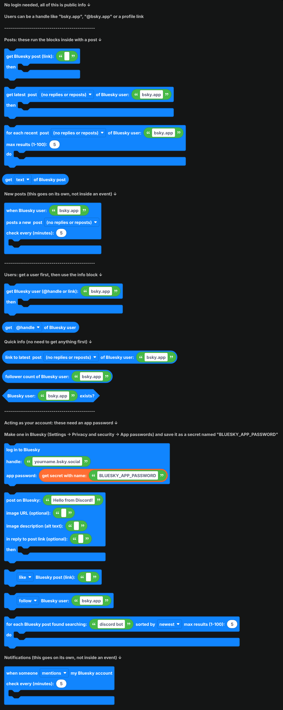
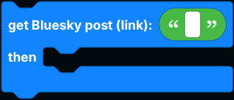
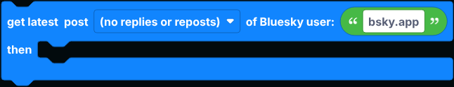
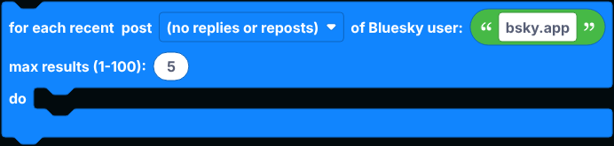
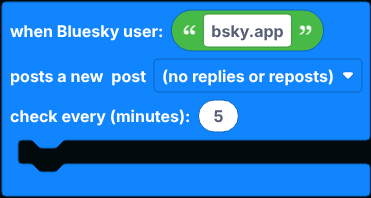
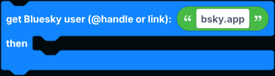
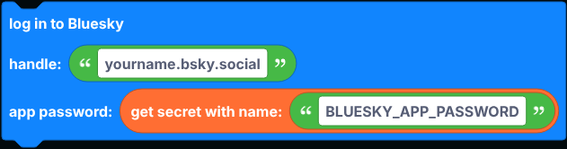
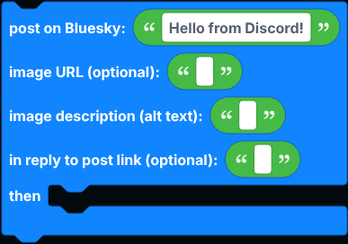
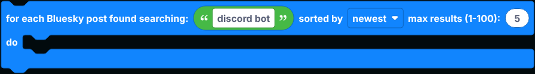
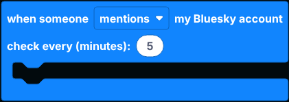

# Bluesky

Blocks for Bluesky: read public posts and profiles, get notified when someone posts, and post, reply, like, follow, search and react to notifications as your own account.

Reading works without any account, through Bluesky's official public API. Acting as your account needs an app password, and those blocks have their own section at the bottom of the flyout.

Wherever a block asks for a user, you can give it a handle (`bsky.app`), an `@handle` or a profile link. Wherever it asks for a post, give it the post's link.

  
Show the whole Bluesky flyout

## Posts

These run the blocks inside them with a post. Inside, `get ... of Bluesky post` reads from it. The dropdowns pick posts only, posts and reposts, or posts and replies.

| Block | What it does |
| --- | --- |
|  | Looks up one post by its link. |
|  | Gets a user's newest post. Pinned posts are skipped. |
|  | Runs once for each of a user's latest posts, newest first. |

`get ... of Bluesky post` reads the text, link, the author's handle, name, link and profile picture, likes, reposts, replies, quotes, post date, a list of image URLs, a video's thumbnail, the link card's URL, whether it is a reply, whether it is a repost and by whom, its language, and its `at://` URI.

## New post notifications

`when Bluesky user ... posts a new ...` goes on its own in the workspace, not inside an event. It checks the user every few minutes (at least 1) and runs once for each new post.

## Users

`get Bluesky user ... then ...` looks up a profile.

`get ... of Bluesky user` reads the handle, display name, DID, bio, link, followers, following, post count, profile picture, banner and join date.

## Quick info

| Block | Returns |
| --- | --- |
|  | A link to the user's newest post. |
|  | The user's follower count. |
|  | True when the account exists. |

## Logging in

1. In Bluesky, go to **Settings → Privacy and security → App passwords** and add one. Never use your real password.
2. Save it as a [secret](../../Guide/secrets.md) named `BLUESKY_APP_PASSWORD`.

Put `log in to Bluesky` in `when the bot is logged in`, with your handle.

## Acting as your account

| Block | What it does |
| --- | --- |
|  | Posts up to 300 characters, optionally with an image from a URL (with alt text) or as a reply to another post. Links, `@mentions` and `#hashtags` become clickable. Inside, `get link of Bluesky post` is the new post's link. |
|  | Likes, unlikes, reposts, undoes a repost or deletes a post. You can only delete your own posts. |
|  | Follows or unfollows a user. |
|  | Searches posts, newest or top first, and runs once for each. Supports `from:handle` and `#hashtags`. |

## Notifications

`when someone ... my Bluesky account` goes on its own in the workspace. It checks your notifications every few minutes and runs once for each new mention, reply, quote, follow, like or repost. Inside, `get ... of Bluesky user` is the person who did it, and `get ... of Bluesky post` is their post (for mentions, replies and quotes) or your post they liked or reposted.

## Notes

- Every block here goes over the network, so `defer reply` first inside an interaction.
- Images must be under 1 MB; Bluesky refuses bigger ones.
