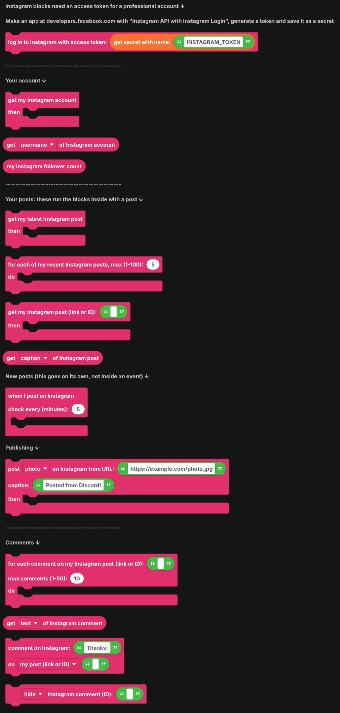
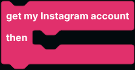
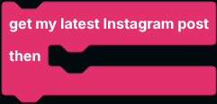
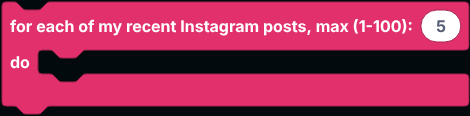
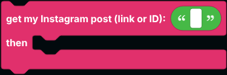
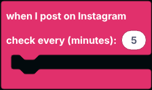
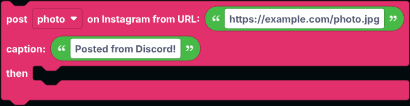
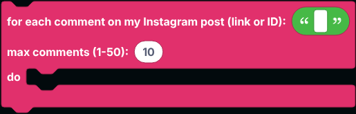
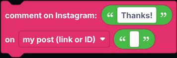

# Instagram

Blocks for Instagram: read your account and posts, share new posts in Discord, publish photos, reels and stories, and manage comments.

Instagram has no public API for reading accounts without logging in, so every Instagram block works on your own account, through the official Instagram API. It must be a **professional** account (Business or Creator). Switching is free in the Instagram app's settings.

  
Show the whole Instagram flyout

## Logging in

1. Go to [developers.facebook.com](https://developers.facebook.com), create an app, and add the **Instagram** product ("Instagram API with Instagram Login").
2. Under **Generate access tokens**, add your Instagram account and generate a token.
3. Save it as a [secret](../../Guide/secrets.md) named `INSTAGRAM_TOKEN`.

Put `log in to Instagram` in `when the bot is logged in`. Tokens last 60 days. While the bot is running it refreshes its copy every day, but the secret itself is not changed, so generate a new token if the bot has been off for a long time.

## Your account

| Block | What it does |
| --- | --- |
|  | Gets your account. Use `get ... of Instagram account` inside. |
|  | Reads the username, name, ID, bio, website, link, profile picture, followers, following, post count or account type. |
|  | Your follower count, without getting the account first. |

## Your posts

These run the blocks inside them with a post. Inside, `get ... of Instagram post` reads from it.

| Block | What it does |
| --- | --- |
|  | Gets your newest post. |
|  | Runs once for each of your latest posts, newest first. |
|  | Looks up one of your posts by its link or ID. |
|  | Goes on its own in the workspace. Checks every few minutes and runs once for each new post, so your server hears about every post. |

`get ... of Instagram post` reads the caption, link, ID, type (photo, video, reel, carousel), the image or video URL, a thumbnail, post date, likes, comment count, username and shortcode.

## Publishing

Posts a photo, reel, photo story or video story from a public URL, then runs the blocks inside with the new post. Photos must be JPEGs, and videos MP4s. Instagram downloads the file itself, so the link must work for anyone, not just you. Videos can take a minute to process. Stories have no caption.

Instagram allows 100 published posts a day through the API.

## Comments

| Block | What it does |
| --- | --- |
|  | Runs once for each comment on one of your posts. |
|  | Inside that, reads the comment's text, username, ID, likes, date, whether it is hidden, and the post ID. |
|  | Comments on one of your posts, or replies to a comment by its ID. |
|  | Hides, unhides or deletes a comment on your posts. |

## Notes

- Every block here goes over the network, so `defer reply` first inside an interaction.
- Reading other people's accounts and sending DMs are not part of these blocks: Instagram only allows them for apps that go through Meta's review.
