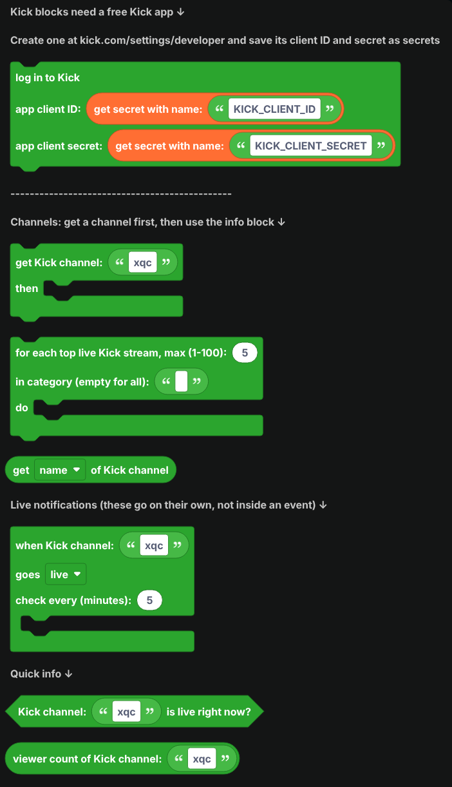
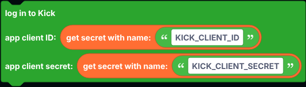
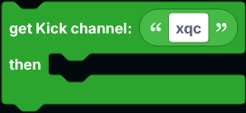
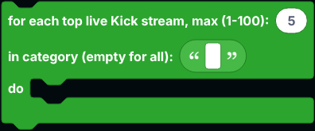
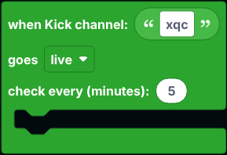

# Kick

Blocks for Kick: read channels and their streams, find the most watched live streams, and get notified when a channel goes live.

Kick only shares this through its official API, so every Kick block needs a free Kick app. Wherever a block asks for a channel, you can give it the channel's name (like `xqc`) or its `kick.com` link.

  
Show the whole Kick flyout

## Logging in

1. Go to [kick.com/settings/developer](https://kick.com/settings/developer) (you need two-factor authentication turned on) and create an app. Use `http://localhost` as the redirect URL.
2. Save its **Client ID** and **Client Secret** as [secrets](../../Guide/secrets.md) named `KICK_CLIENT_ID` and `KICK_CLIENT_SECRET`.

Put `log in to Kick` in `when the bot is logged in`. The blocks only read public info, so no Kick account login is needed.

## Channels

| Block | What it does |
| --- | --- |
|  | Looks up a channel and its stream. |
|  | Runs once for each of the most watched live streams, optionally only in one category. |

`get ... of Kick channel` reads the name, link, user ID, description, whether it is live, the stream title, category, viewer count, start time, thumbnail, language, whether it is for mature audiences, the banner image and the profile picture. The profile picture is only known for channels from the top streams block; the description and banner only for channels you got by name.

## Live notifications

`when Kick channel ... goes live` goes on its own in the workspace, not inside an event. It checks the channel every few minutes (at least 1) and runs the blocks inside when a stream starts, or ends if you pick **offline**. Use `get ... of Kick channel` inside.

## Quick info

| Block | Returns |
| --- | --- |
|  | True while the channel is streaming. |
|  | How many people are watching, or 0 when offline. |

## Notes

- Every block here goes over the network, so `defer reply` first inside an interaction.
- Sending Kick chat messages needs a Kick account login, which these blocks do not do.
