# Reddit

Blocks for Reddit: read posts, comments, subreddits and users, get a random meme, and post new posts to a Discord channel as they arrive. None of this needs an account. Logging in with a Reddit app is optional for reading, and needed to post, reply and send messages.

Subreddits can be written like `memes`, `r/memes` or a reddit.com link, and users like `spez` or `u/spez`.

  
Show the whole Reddit flyout

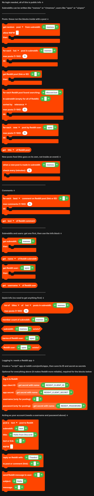

## Posts

These run the blocks inside them with a post. Inside, `get ... of Reddit post` reads from it.

| Block | What it does |
| --- | --- |
| 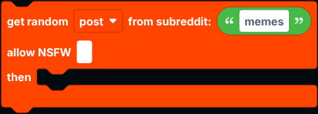 | Picks a random post from the subreddit's hot posts. Pick **image post** for a meme command. NSFW posts are skipped unless you tick the box. |
| 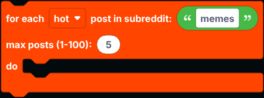 | Runs once for each post, sorted by hot, new, rising, top or controversial. |
| 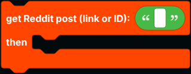 | Looks up one post by its link or ID. |
| 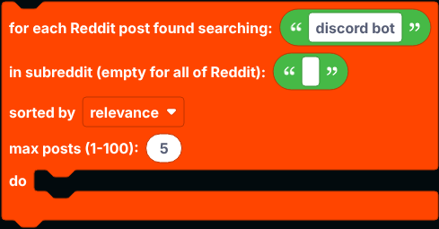 | Searches one subreddit, or all of Reddit if the subreddit is empty. |
| 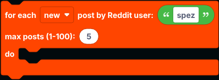 | Runs once for each post a user made. |

`get ... of Reddit post` reads the title, text, link to the post, the URL it links to, its image URL, thumbnail, author, subreddit, score, upvote ratio, comment count, date, flair, and whether it is NSFW, a spoiler, pinned, a video or a text post.

## New post feeds

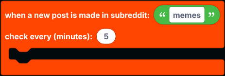

`when a new post is made in subreddit ...` goes on its own in the workspace, not inside an event. It checks the subreddit every few minutes (at least 1) and runs once for each new post. Posts that were already there when the bot started are skipped.

## Comments

| Block | What it does |
| --- | --- |
| 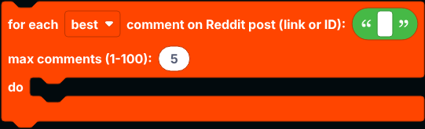 | Runs once for each top-level comment on a post. |
|  | Inside that, reads the comment's text, author, score, reply count, date or link. |

## Subreddits and users

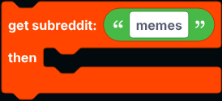

`get subreddit ... then ...` looks up a subreddit, and `get ... of Reddit subreddit` reads its name, title, description, sidebar, member count, members online, creation date, type, icon, banner, colour and link.

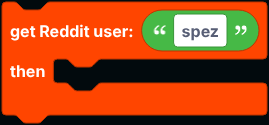

`get Reddit user ... then ...` looks up a user, and `get ... of Reddit user` reads their karma (total, post or comment), account creation date, avatar, bio, profile link and more.

## Quick info

| Block | Returns |
| --- | --- |
| 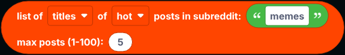 | A list of the titles, links or image URLs of a subreddit's posts. |
|  | How many members a subreddit has. |
|  | True when a subreddit exists and is public. |
|  | A user's total karma. |
|  | True when an account exists and is not suspended. |

## Logging in

Reddit sometimes refuses requests from servers that are not logged in. When that happens, post blocks fall back to Reddit's public RSS feeds, which always work but do not include scores, comment counts, NSFW or flair (those are `null`). Subreddit and user info has no fallback.

Logging in fixes this, and it is needed for posting:

1. Go to [reddit.com/prefs/apps](https://www.reddit.com/prefs/apps) and create an app of type **script**. Any redirect URI works, like `http://localhost`.
2. Save the ID under the app's name as a [secret](../../Guide/secrets.md) named `REDDIT_CLIENT_ID`, and the secret as `REDDIT_CLIENT_SECRET`.
3. Put `log in to Reddit` in `when the bot is logged in`.

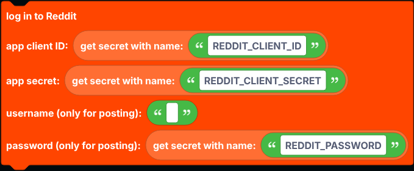

With only the ID and secret, every Reddit block reads through Reddit's official API. To post as an account, also give it the account's username and password (save the password as a secret named `REDDIT_PASSWORD`). The app must belong to that account, and the account cannot have two-factor authentication turned on.

| Block | What it does |
| --- | --- |
| 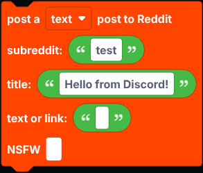 | Posts a text or link post to a subreddit. |
| 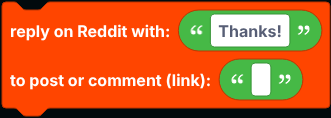 | Comments on a post, or replies to a comment, by its link. |
| 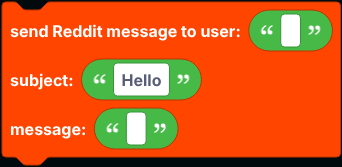 | Sends a private message to a user. |

Follow Reddit's rules and each subreddit's rules about bots.

## Notes

- Every block here goes over the network, so `defer reply` first inside an interaction.
- Reddit rate limits requests. Add a [cooldown](../cooldowns.md) to commands that use these blocks.

## A worked example: a meme command

1. A slash command `meme`.
2. `defer reply`.
3. `get random image post from subreddit memes then`:
4. Reply with an embed whose title is `get title of Reddit post` and whose image is `get image URL of Reddit post`.
