# Roblox

Blocks for reading public Roblox information: users, groups, games, servers, badges, gamepasses and avatar shop items. No API key is needed for any of that, because it is all public. A last section of blocks talks to **your own game** (messages, DataStores and bans) and needs an Open Cloud API key.

  
Show the whole Roblox flyout

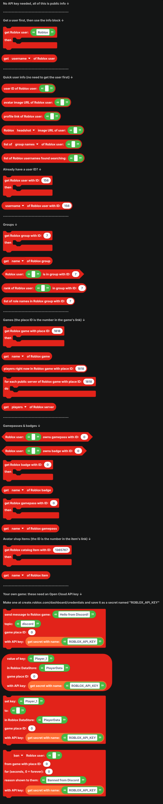

## Users

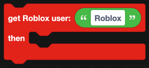

`get Roblox user ... then ...` looks a user up. Blocks in the `then` part run once the lookup finishes.

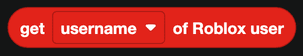

Inside that part, `get ... of Roblox user` reads a property. The dropdown offers username, display name, description, ID, creation date, whether the account is banned, friend and follower counts, avatar image and profile link.

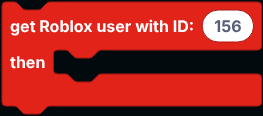

Already have a user ID? `get Roblox user with ID ... then ...` does the same from the ID.

### Quick lookups

These do not need the user fetched first:

| Block | Returns |
| --- | --- |
| 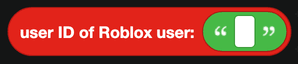 | The numeric user ID. |
| 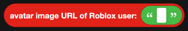 | A URL to the avatar image. |
| 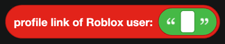 | A link to the profile page. |
| 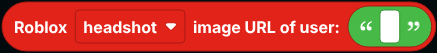 | A URL to a headshot, bust or full avatar picture. |
| 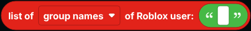 | A list of the user's group names, group IDs, previous usernames or the games they made. |
| 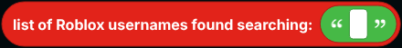 | Up to 10 usernames matching a search. |
| 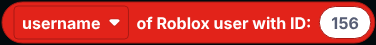 | The username or display name of a user ID. |

## Groups

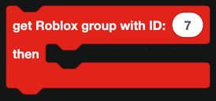

`get Roblox group with ID ... then ...` fetches a group.

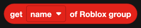

`get ... of Roblox group` reads a property: name, description, member count, owner and so on.

| Block | Returns |
| --- | --- |
| 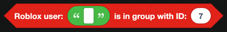 | True when a user is a member of a group. |
| 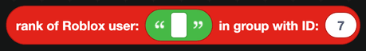 | The user's rank name in that group. |
| 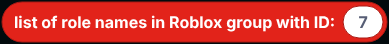 | A list of the group's role names, lowest rank first. |

These two are what a Roblox verification bot is built from: check the group, then give a Discord role to match.

## Games

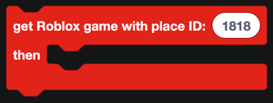

`get Roblox game with place ID ... then ...` fetches a game. The place ID is the number in the game's URL.

`get ... of Roblox game` reads a property: name, description, visits, players online, favorites, likes, dislikes, like percentage, genre, universe ID, icon, thumbnail and more.

| Block | What it does |
| --- | --- |
| 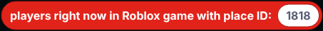 | How many people are playing right now. |
| 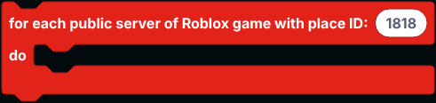 | Runs once for each public server (up to 100, fullest first). |
|  | Inside that, reads the server's players, max players, FPS, ping, ID or a join link. |

## Badges, gamepasses and items

| Block | Returns |
| --- | --- |
| 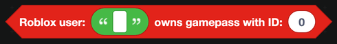 | True when a user owns a gamepass. |
| 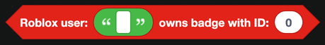 | True when a user owns a badge. |

To read about the badge, gamepass or avatar shop item itself, get it first, then use its info block inside:

| Get | Info |
| --- | --- |
| 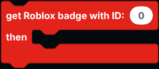 |  Name, description, times awarded (ever and yesterday), win rate, game, icon and link. |
| 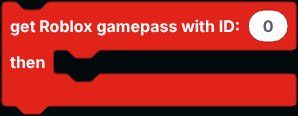 |  Name, description, price, whether it is for sale, creator, icon and link. |
| 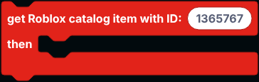 |  Name, description, price, whether it is for sale or limited, copies remaining, creator, image and link. |

All of them take an ID, which you can find in the URL on the Roblox site.

## Your own game (Open Cloud)

These blocks talk to a game you own, so they need an Open Cloud API key:

1. Go to [create.roblox.com/dashboard/credentials](https://create.roblox.com/dashboard/credentials) and create an API key.
2. Add your game to it, with the permissions the blocks below say they need.
3. Save the key as a [secret](../../Guide/secrets.md) named `ROBLOX_API_KEY`. The blocks come with `get secret with name ROBLOX_API_KEY` already plugged in.

Every block takes the game's place ID, the number in its link.

| Block | What it does | Permission |
| --- | --- | --- |
| 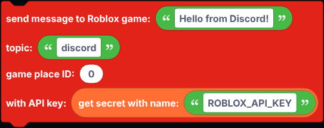 | Sends a message to every running server. In the game, receive it with `MessagingService:SubscribeAsync(topic)`. | `messaging-service:publish` |
| 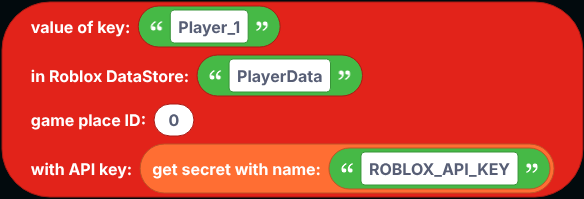 | Reads a value the game saved with `DataStoreService`. | `universe-datastores.objects:read` |
| 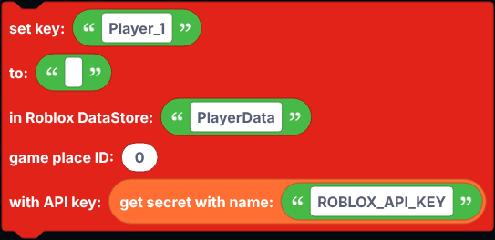 | Saves a value the game can read. | `universe-datastores.objects:create` and `update` |
| 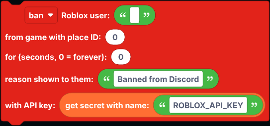 | Bans or unbans a player, even from servers already running. A duration of 0 bans forever. | `universe.user-restriction:write` |

## Verification

These blocks read public data. They do **not** prove that the Discord user in front of you owns the Roblox account they typed in.

The usual way to prove it is to give the person a short code, ask them to put it in their Roblox profile description, then read the description back with `get description of Roblox user` and check the code is there.

## Notes

- Every block here goes over the network, so `defer reply` first inside an interaction.
- Roblox rate limits requests. Add a [cooldown](../cooldowns.md) to commands that use these blocks.
- Wrap them in a `try` block from [JavaScript](../javascript.md), so a misspelled username gives a friendly reply instead of a failure.

## A worked example: a Roblox group role

1. A slash command `verify` with a text option `roblox_username`.
2. `defer reply`.
3. `Roblox user <option> is in group with ID <your group ID>`.
4. If true, `add role to member` with your Verified role, and reply with a confirmation.
5. If false, reply telling them to join the group first.
