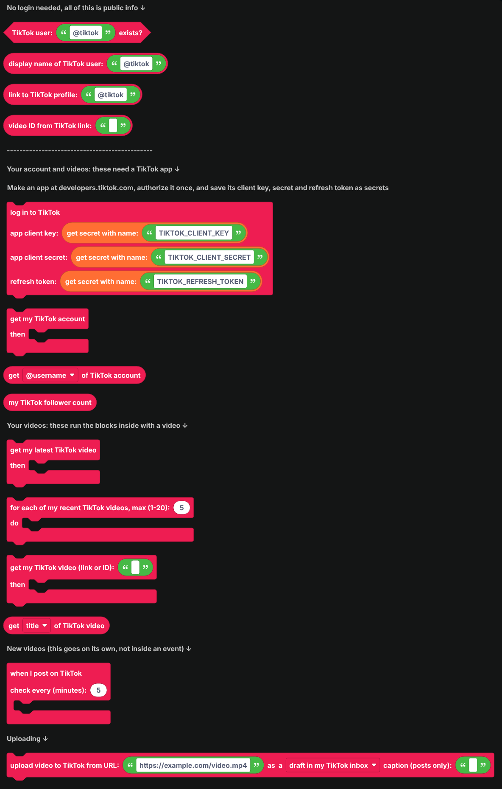
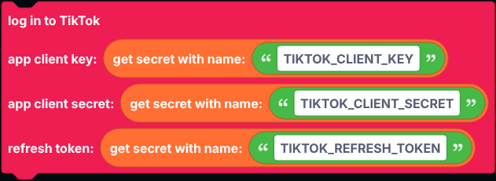
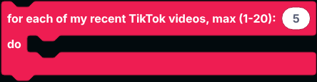
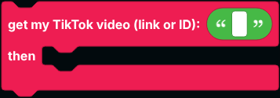
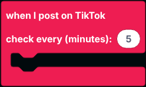

# TikTok

Blocks for TikTok: check accounts, read your own account and videos, share new videos in Discord, and upload videos.

TikTok only shares a little without logging in, so most of these blocks work on your own account through TikTok's official API. Those have their own section in the flyout.

  
Show the whole TikTok flyout

## No login needed

| Block | Returns |
| --- | --- |
|  | True when a public account with that username exists. |
|  | The account's display name. |
|  | The link to a username's profile. |
|  | The video ID taken out of a TikTok link. Short `vm.tiktok.com` links work too. |

## Logging in

The other blocks need a TikTok app, set up once:

1. Go to [developers.tiktok.com](https://developers.tiktok.com), create an app, and add **Login Kit**. To read stats and videos, add the `user.info.profile`, `user.info.stats` and `video.list` scopes. To upload, add **Content Posting API** with `video.upload` (drafts) or `video.publish` (direct posts).
2. Authorize the app with your TikTok account once, through Login Kit, and keep the **refresh token** it gives you. It lasts a year; the bot uses it to get fresh access tokens by itself.
3. Save the app's **client key** and **client secret** and the refresh token as [secrets](../../Guide/secrets.md) named `TIKTOK_CLIENT_KEY`, `TIKTOK_CLIENT_SECRET` and `TIKTOK_REFRESH_TOKEN`.

Put `log in to TikTok` in `when the bot is logged in`.

## Your account

| Block | What it does |
| --- | --- |
|  | Gets your account. Use `get ... of TikTok account` inside. |
|  | Reads the username, display name, bio, link, profile picture, whether it is verified, followers, following, total likes, video count or open ID. |
|  | Your follower count, without getting the account first. |

## Your videos

These run the blocks inside them with one of your public videos. Inside, `get ... of TikTok video` reads from it.

| Block | What it does |
| --- | --- |
|  | Gets your newest video. |
|  | Runs once for each of your latest videos (up to 20), newest first. |
|  | Looks up one of your videos by link or ID. |
|  | Goes on its own in the workspace. Checks every few minutes and runs once for each new video. |

`get ... of TikTok video` reads the title, description, link, ID, embed link, cover image, length in seconds, post date, views, likes, comments and shares.

## Uploading videos

Downloads an MP4 from a URL and uploads it to your account, either as a draft in your TikTok app's inbox (finish and post it there) or as a post with the visibility you pick. Until TikTok audits your app, direct posts can only be visible to you.

## Notes

- Every block here goes over the network, so `defer reply` first inside an interaction.
- TikTok does not let apps read other people's videos or live status, so notifications only work for your own account.
