# Twitch

Blocks for Twitch: check whether a channel is live, get notified when a stream starts, and read channels, videos, clips and the most watched streams.

Live stream info works without any account. Channels, videos, clips and the directory use Twitch's official API, which needs a free Twitch app. They have their own section at the bottom of the flyout.

Wherever a block asks for a channel, you can give it the channel's name (like `shroud`) or its `twitch.tv` link.

  
Show the whole Twitch flyout

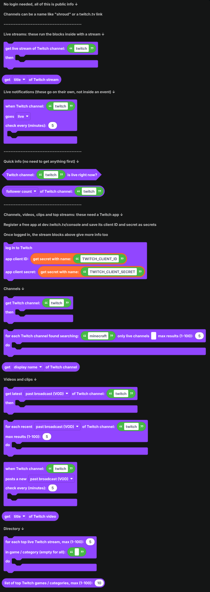

## Live streams

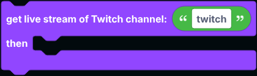

`get live stream of Twitch channel ... then ...` runs the blocks inside only while the channel is live. Inside it, `get ... of Twitch stream` reads from the stream.

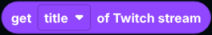

`get ... of Twitch stream` reads the title, game or category, viewer count, link, thumbnail image, the channel's login and display name, when the stream started, its language, its tags and whether it is for mature audiences. Language, tags and mature need [`log in to Twitch`](#logging-in); without it they are `null`.

## Live notifications

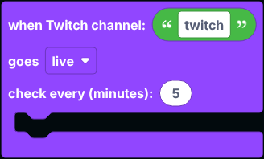

`when Twitch channel ... goes live` goes on its own in the workspace, not inside an event. It checks the channel every few minutes (at least 1) and runs the blocks inside when a stream starts. Pick **goes offline** in the dropdown to run them when the stream ends instead.

Use `get ... of Twitch stream` inside. If the channel is already live when the bot starts, nothing runs until its next stream, so restarting the bot does not repeat notifications.

## Quick info

These do not need anything fetched first, and work without logging in:

| Block | Returns |
| --- | --- |
|  | True while the channel is streaming. |
| 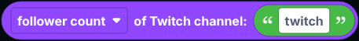 | The follower count, stream title, game, viewer count, uptime, profile picture, user ID, account creation date, account age, a link to the latest past broadcast, or the channel link. Title and game are the last ones used, even when the channel is offline. |

Without logging in, these blocks read public info from [DecAPI](https://decapi.me), a free service made for Twitch chat bots.

## Logging in

The rest of the blocks use Twitch's official API. It is free:

1. Go to [dev.twitch.tv/console](https://dev.twitch.tv/console) and register an application. Any name works; use `http://localhost` as the OAuth redirect URL and **Confidential** as the client type.
2. Copy its **Client ID**, then create a **Client Secret**.
3. Save them as [secrets](../../Guide/secrets.md) named `TWITCH_CLIENT_ID` and `TWITCH_CLIENT_SECRET`.

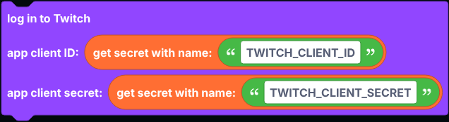

Put `log in to Twitch` in `when the bot is logged in`. Once it has run, the live stream blocks above use the official API too.

## Channels

| Block | What it does |
| --- | --- |
| 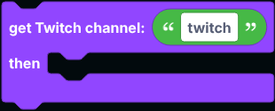 | Looks up a channel. |
| 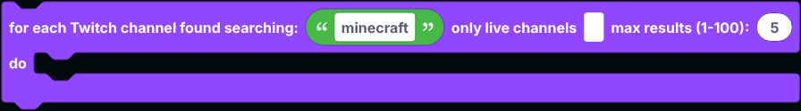 | Searches channels by name and runs once for each one found. Tick the box to only find live channels. |

`get ... of Twitch channel` reads the display name, login name, user ID, description, link, profile picture, offline banner, whether it is a partner or affiliate, creation date, stream title, game, language, tags and whether it is live right now. Channels from a search have no description, banner or creation date.

## Videos and clips

The dropdowns pick past broadcasts (VODs), highlights, uploads, videos of any type, or clips.

| Block | What it does |
| --- | --- |
| 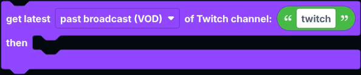 | Gets the channel's newest video or clip. |
| 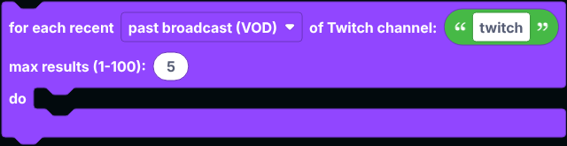 | Runs once for each of the channel's latest videos or clips, newest first. Clips come from the last 30 days. |
| 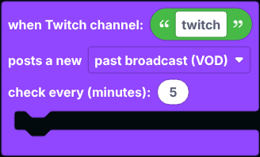 | Goes on its own in the workspace. Runs once for each new video or clip. |

`get ... of Twitch video` reads the title, link, ID, description, thumbnail, views, length in seconds, creation date, type, channel name and, for clips, who clipped it.

## Directory

| Block | What it does |
| --- | --- |
| 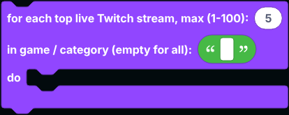 | Runs once for each of the most watched live streams, optionally only in one game or category. Use `get ... of Twitch stream` inside. |
| 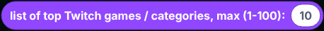 | A list of the most watched games and categories right now. |

## Notes

- Every block here goes over the network, so `defer reply` first inside an interaction.
- Sending messages in Twitch chat is not part of these blocks: it needs a Twitch account login, not just an app.

## A worked example: live notifications

1. Drag `when Twitch channel ... goes live` into the workspace, on its own.
2. Type the channel's name.
3. Inside it, send a message to your announcements channel: `get channel display name of Twitch stream` joined with ` is live: `, then `get title of Twitch stream` and `get link of Twitch stream`. Put `get thumbnail image URL of Twitch stream` in an embed's image for a preview.
