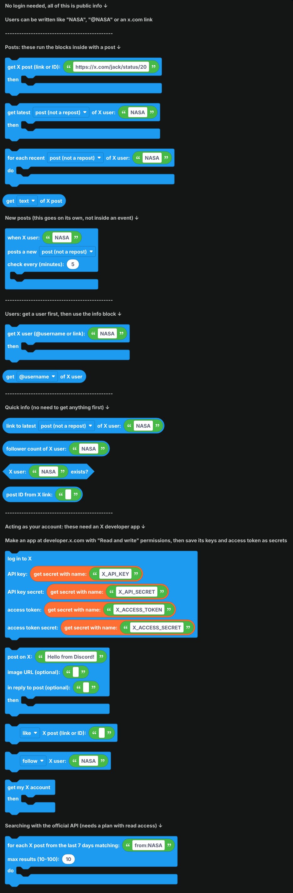
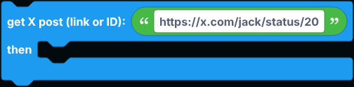
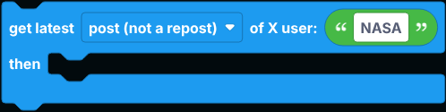
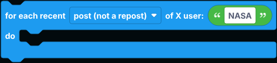
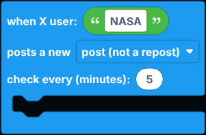
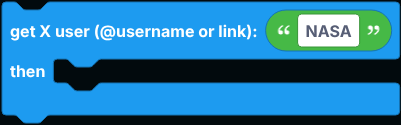
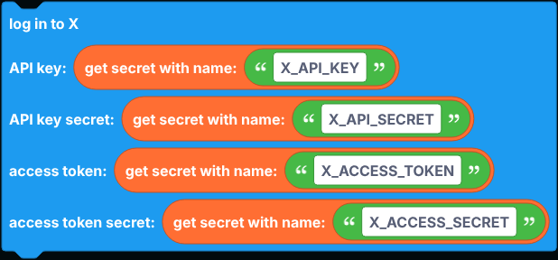
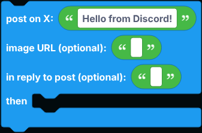
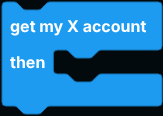
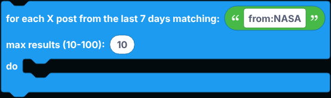

# X (Twitter)

Blocks for X, formerly Twitter: read public posts and profiles, get notified when someone posts, and post, like, repost and follow as your own account.

Reading works without any account. Acting as your account needs an X developer app, and those blocks have their own section at the bottom of the flyout.

Wherever a block asks for a user, you can give it a username (`NASA`), an `@username` or a profile link. Wherever it asks for a post, you can give it a post link (`x.com` or `twitter.com`) or the post's ID.

  
Show the whole X flyout

## Posts

These run the blocks inside them with a post. Inside, `get ... of X post` reads from it. The dropdowns pick posts only, posts and reposts, or reposts only.

| Block | What it does |
| --- | --- |
|  | Looks up one post by link or ID. |
|  | Gets a user's newest post. |
|  | Runs once for each of a user's latest posts (up to 20), newest first. |

`get ... of X post` reads the text, link, ID, the author's username, name, link and profile picture, likes, reposts, replies, quotes, bookmarks, views, post date, a list of image URLs, the video URL, a list of all media URLs, whether it is a reply and to whom, whether it is a repost and by whom, its language, and whether it is marked sensitive. Anything X does not share is `null`.

## New post notifications

`when X user ... posts a new ...` goes on its own in the workspace, not inside an event. It checks the user every few minutes (at least 1) and runs once for each new post. Posts that were already there when the bot started do not count.

## Users

`get X user ... then ...` looks up a profile.

`get ... of X user` reads the username, display name, ID, bio, location, website, link, followers, following, post count, likes count, media count, profile picture, banner, join date, and whether the account is verified or protected.

## Quick info

| Block | Returns |
| --- | --- |
|  | A link to the user's newest post. |
|  | The user's follower count. |
|  | True when the account exists. |
|  | The post ID taken out of a link. |

X's own API does not let anyone read for free, so these blocks read public posts and profiles through [FxTwitter](https://github.com/FxEmbed/FxEmbed), a free, open-source API built for embedding X posts. Protected accounts' posts are not available.

## Acting as your account

These use X's official API with your own developer app:

1. Sign in at [developer.x.com](https://developer.x.com) with the account the bot should post as, and open the developer portal.
2. In your app's **User authentication settings**, set the app permissions to **Read and write**.
3. Under **Keys and tokens**, copy the **API Key and Secret**, then generate an **Access Token and Secret**. Generate the access token after setting the permissions, or it will be read-only.
4. Save the four values as [secrets](../../Guide/secrets.md) named `X_API_KEY`, `X_API_SECRET`, `X_ACCESS_TOKEN` and `X_ACCESS_SECRET`.

Put `log in to X` in `when the bot is logged in`.

| Block | What it does |
| --- | --- |
|  | Posts on X, optionally with an image from a URL or as a reply to another post. Inside, `get link of X post` is the new post's link. |
|  | Likes, unlikes, reposts, undoes a repost or deletes a post. You can only delete your own posts. |
|  | Follows or unfollows a user. |
|  | Gets your own account. Use `get ... of X user` inside. |
|  | Searches posts from the last 7 days and runs once for each. Supports X's search operators, like `from:NASA` or `#discord`. |

X charges for API use: posting works on the free plan within its monthly limit, while reading (your account, looking up users to follow, and search) needs a plan with read access. If the plan does not allow something, the block does nothing and the error is written to the bot's console.

## Notes

- Every block here goes over the network, so `defer reply` first inside an interaction.
- Follow X's automation rules when posting from a bot.
