# YouTube

Blocks for YouTube: read public videos, channels and playlists, and get notified when a channel uploads or goes live. Almost everything works without an API key. Search, comments and exact statistics need a free YouTube API key, and they have their own section at the bottom of the flyout.

Wherever a block asks for a channel, you can give it an `@handle` (like `@YouTube`), a channel link, or a channel ID (the one starting with `UC`). Wherever it asks for a video, you can give it any YouTube link (watch, `youtu.be`, Shorts or live) or the 11-character video ID.

  
Show the whole YouTube flyout

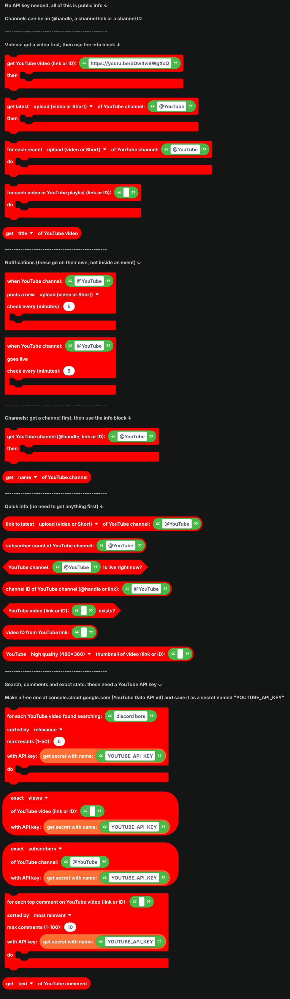

## Videos

These run the blocks inside them with a video. Inside, `get ... of YouTube video` reads from it.

| Block | What it does |
| --- | --- |
| 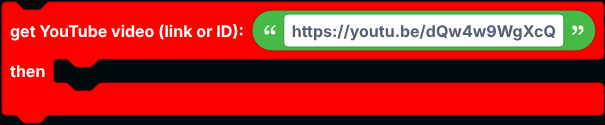 | Looks up one video by link or ID. |
| 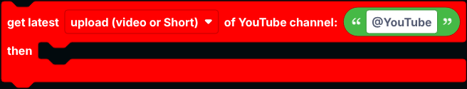 | Gets a channel's newest upload. The dropdown picks any upload, only videos, or only Shorts. |
| 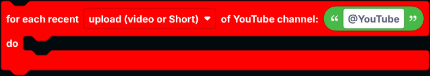 | Runs once for each of a channel's latest uploads (up to 15), newest first. |
| 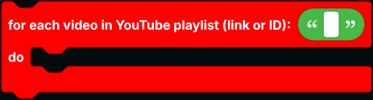 | Runs once for each video in a public playlist (the first 15). |

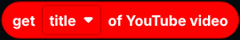

`get ... of YouTube video` reads the title, description, link, ID, channel name, channel ID and link, views, likes, upload date, length in seconds, thumbnail URL, whether it is a Short, whether it is live, its category and its tags.

Not every block knows everything. Videos from a channel's uploads or a playlist come from YouTube's public feed, which has likes but no length or tags. Videos you get by link have length and tags but no likes. Anything missing is `null`.

## Upload and live notifications

These two blocks go on their own in the workspace, not inside an event. They check the channel every few minutes (at least 1) and run the blocks inside when something new happens.

| Block | Runs when |
| --- | --- |
| 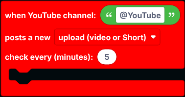 | The channel posts a new upload, video or Short. It runs once for each new one. |
| 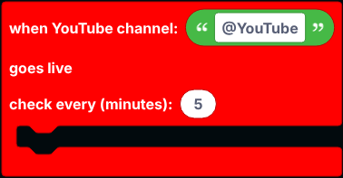 | The channel starts a livestream. |

Use `get ... of YouTube video` inside them. Nothing runs for videos that were already there when the bot started, so restarting the bot does not repeat old notifications.

## Channels

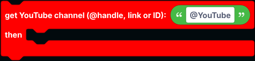

`get YouTube channel ... then ...` looks up a channel.

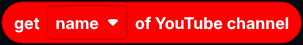

`get ... of YouTube channel` reads its name, @handle, description, ID, link, subscriber count, video count, creation date, profile picture, banner and whether it is family safe. YouTube rounds public subscriber counts, so `1.23M` becomes `1230000`. The "text" options give the count the way YouTube shows it.

## Quick info

These do not need anything fetched first:

| Block | Returns |
| --- | --- |
| 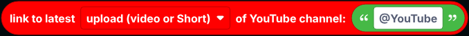 | A link to the channel's newest upload. |
| 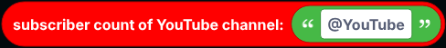 | The subscriber count as YouTube shows it, like `1.23M`. |
|  | True while the channel is livestreaming. |
| 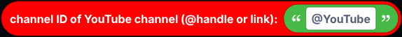 | The channel ID of a handle or link. |
|  | True when a link or ID points to a public or unlisted video. |
| 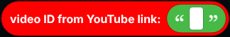 | The video ID taken out of any YouTube link. |
| 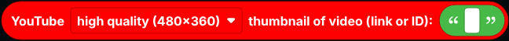 | A link to the video's thumbnail image, in the quality you pick. Great in embeds. Not every video has a max quality thumbnail. |

## With an API key

Searching, reading comments and exact numbers are only available through the YouTube Data API, which needs a key. It is free:

1. Go to [console.cloud.google.com](https://console.cloud.google.com), create a project, and enable **YouTube Data API v3**.
2. Under **Credentials**, create an **API key**.
3. Save it as a [secret](../../Guide/secrets.md) named `YOUTUBE_API_KEY`. The blocks come with `get secret with name YOUTUBE_API_KEY` already plugged in.

| Block | What it does |
| --- | --- |
| 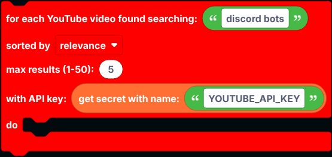 | Searches YouTube and runs once for each video found. Use `get ... of YouTube video` inside it. |
| 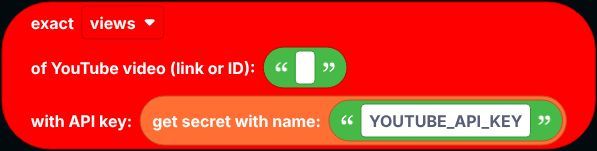 | The exact views, likes or comment count of a video. |
| 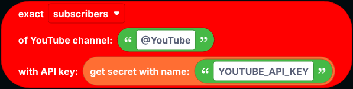 | A channel's subscribers, total views or video count. |
| 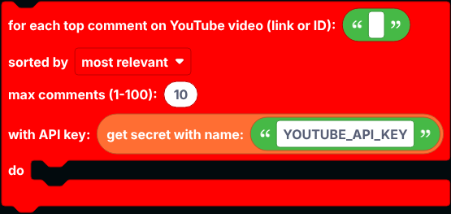 | Runs once for each top-level comment on a video. |
| 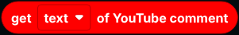 | Inside that, reads the comment's text, author, likes, reply count, date or link. |

Google gives every key a daily quota. A search uses far more of it than the other blocks, so add a [cooldown](../cooldowns.md) to search commands.

## Notes

- Every block here goes over the network, so `defer reply` first inside an interaction.
- The blocks without a key read YouTube's public pages. If YouTube refuses a request, they give `null` (or `false`) rather than an error.

## A worked example: upload notifications

1. Drag `when YouTube channel ... posts a new ...` into the workspace, on its own.
2. Type the channel's `@handle`, and pick **upload (video or Short)**.
3. Inside it, send a message to your announcements channel: `New video: ` joined with `get title of YouTube video`, then `get link of YouTube video` on a new line.
