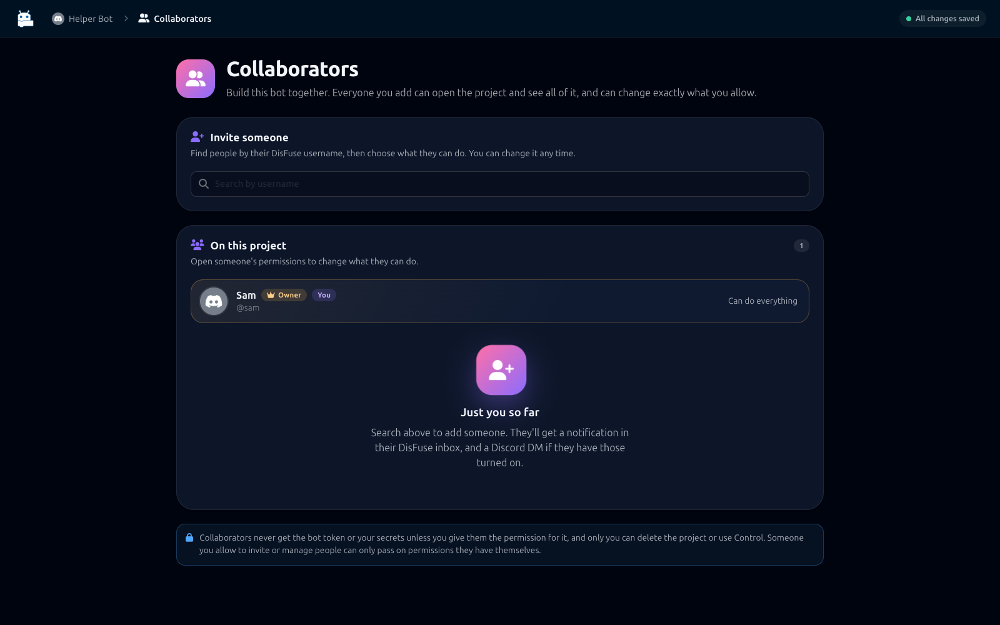

# Collaborators

Build your bot with other people. Everyone you add can open the project and see all of it, and can change exactly what you allow.

Open **Collaborators** from the project's dashboard.

## Inviting someone

Search for them by their DisFuse username under **Invite someone**, then choose what they can do. They get a notification in their DisFuse [inbox](../Features/inbox.md), and a Discord DM if they have those turned on.

## Permissions

Start from one of three presets, then change any single permission:

| Preset | What they can do |
| --- | --- |
| **Can view** | See the whole project, but change nothing. |
| **Can build** | Make and change commands, events, steps and variables. |
| **Full access** | Every permission, including seeing and changing the bot token. |

The permissions are grouped by area: **Commands**, **Options and subcommands**, **Steps in commands**, **Events**, **Steps in events**, **Variables**, **Secrets**, **Project settings**, **Insights** and **Collaborators**. Each one says what it allows. For example, someone can be allowed to change steps but not delete them, or to add secrets but not see their values.

Open someone under **On this project** to change their permissions or remove them.

## What only the owner can do

Collaborators never get the bot token or your secrets unless you give them the permission for it. Only the owner can delete the project or use [Control](../Features/control.md).

Someone allowed to invite or manage people can only pass on permissions they have themselves.
