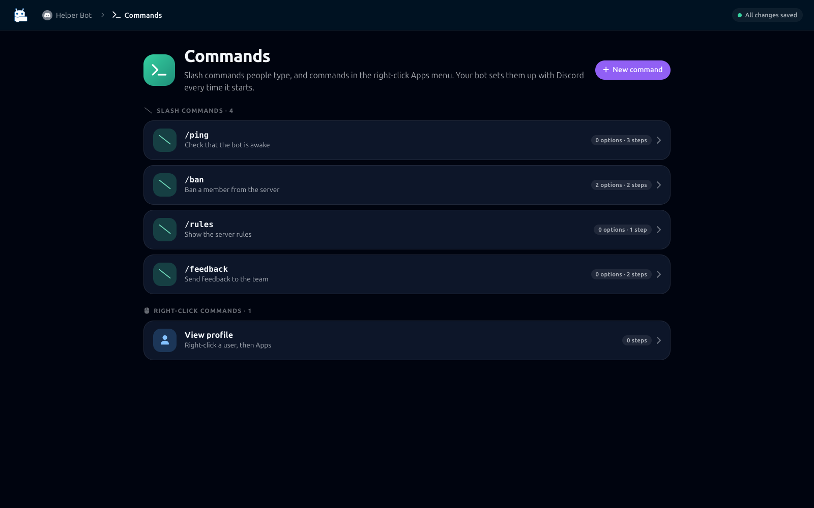
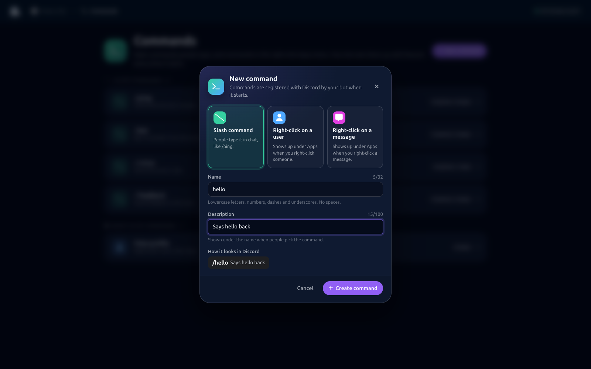
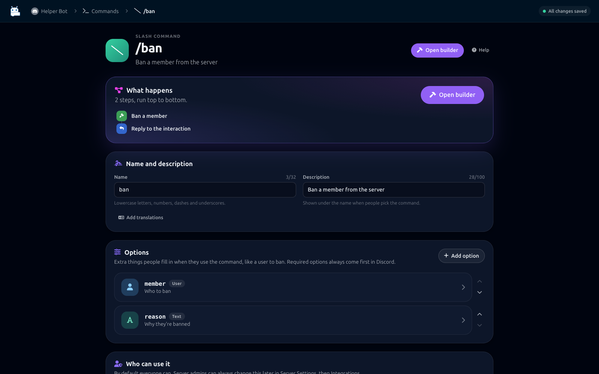
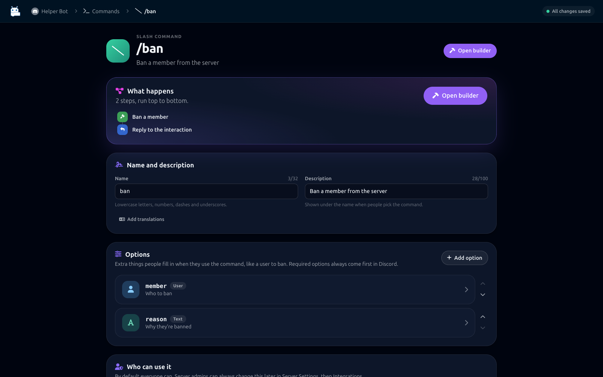
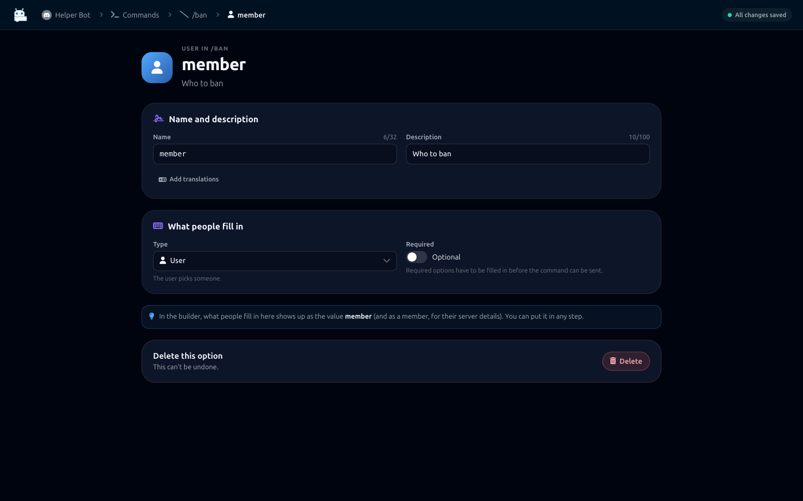

# Commands

The **Commands** page lists every command your bot has. Slash commands are listed first, then right-click commands.

Your bot registers its commands with Discord every time it starts, so there's nothing else to set up.

## Making a command

Click **New command**, choose what kind it is, and give it a name.

| Kind | Where people find it |
| --- | --- |
| **Slash command** | People type `/` and its name in chat, like `/ping`. |
| **Right-click on a user** | Right-click someone, then **Apps**. |
| **Right-click on a message** | Right-click a message, then **Apps**. |

Slash command names use lowercase letters, numbers, dashes and underscores, with no spaces, up to 32 characters. They also need a description of up to 100 characters, shown under the name when people pick the command. Right-click commands can have spaces and capital letters, and have no description.

A bot can have up to 100 slash commands, 5 right-click commands on users and 5 on messages. Those are Discord's limits.

## A command's page

Click a command to open its page.

| Section | What it's for |
| --- | --- |
| **What happens** | The steps the command runs. Click **Open builder** to change them. See [Steps](steps.md). |
| **Name and description** | Its name, its description, and **Add translations** for other languages. |
| **Options** | Things people fill in when they use the command. See below. |
| **Who can use it** | The permissions people need to use it, and whether it's age-restricted. |
| **Where it works** | Servers, DMs and group DMs, and whether it can be added to servers, to people's own accounts, or both. |

## Options

Options are the extra things people fill in when they use a slash command, like the user to ban or the reason why.

Click **Add option** and choose its type.

| Type | What people pick |
| --- | --- |
| **Text** | Any text they type. |
| **Whole number** | A number with no decimals, like 5. |
| **Number** | Any number, decimals allowed, like 2.5. |
| **True or false** | True or False. |
| **User** | Someone in the server. |
| **Channel** | A channel. |
| **Role** | A role. |
| **User or role** | Either one. |
| **File** | A file they upload. |

Click an option to change it. Each option has a name, a description, whether it's required, and settings that depend on its type: a list of **choices** for text and numbers, minimum and maximum values or lengths, the kinds of channels allowed, and **suggestions** shown as people type.

The arrows next to each option change their order. Discord always lists required options first.

In a command's steps, every option is a [value](values.md) you can use: "the user they picked", "the reason they typed", and so on.

## Subcommands

A slash command can have subcommands instead of steps of its own, like `/settings view` and `/settings reset`. Add one with **Add option** and choose **Subcommand**. Subcommands can be put into **subcommand groups** too, like `/settings roles add`.

A command with subcommands doesn't run steps itself. Each subcommand has its own page with its own options and its own **Open builder**.

## Right-click commands

A right-click command runs its steps when someone picks it from the **Apps** menu. In its steps you can use the user or message that was right-clicked.
