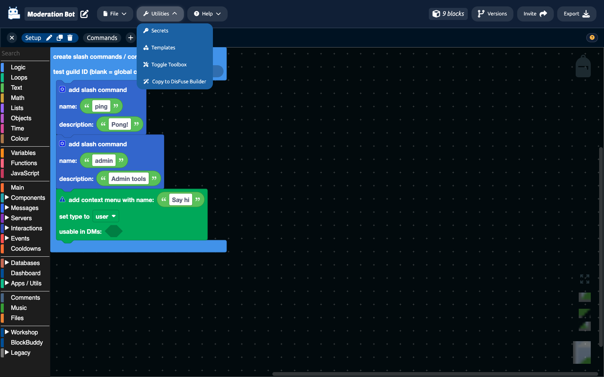
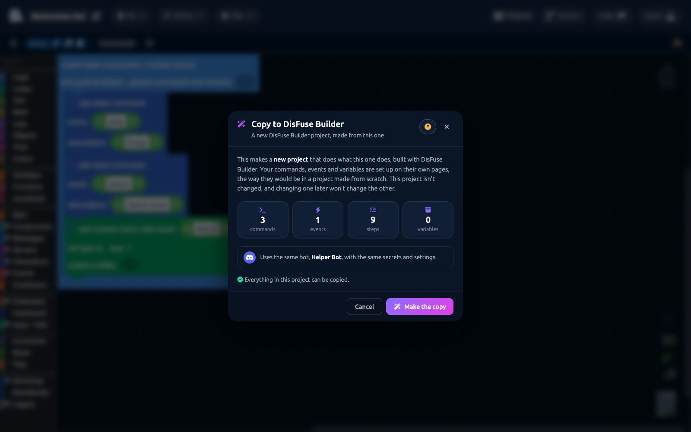

# Copy a block project

Any project made with the block editor can be copied into a new DisFuse Builder project. In the block editor, open **Utilities** and click **Copy to DisFuse Builder**.

The copy is a **new project**. Your block project isn't changed, and changing one later won't change the other.

## What gets copied

DisFuse reads every workspace and sets the project up the way it would be if you made it in DisFuse Builder from the start:

- The commands your blocks create become [commands](commands.md), with their options and subcommands.
- The steps under **When a slash command is received** that check which command was used are moved into that command's own steps.
- Event blocks become [events](events.md), and the blocks inside them become [steps](steps.md).
- Variables become [variables](variables.md).

The dialog shows how many commands, events, steps and variables it found before you make the copy.

## What can't be copied

If anything can't be copied, the dialog lists it under **Good to know**, grouped by why:

- Blocks from Workshop packs that couldn't be read as steps.
- BlockBuddy blocks, since BlockBuddy isn't in DisFuse Builder.
- Blocks with nothing like them in DisFuse Builder.
- Steps where a setting or value didn't fit.

The steps around anything left out are kept. Open the copy afterwards to check it.

## Which bot it uses

The copy uses the same bot, with the same secrets and settings, and counts as one more project on your plan.

A bot can only have one DisFuse Builder project. If yours already has one, DisFuse asks for another bot's token, and the copy uses that bot instead.

Only the project's owner can make a copy.
