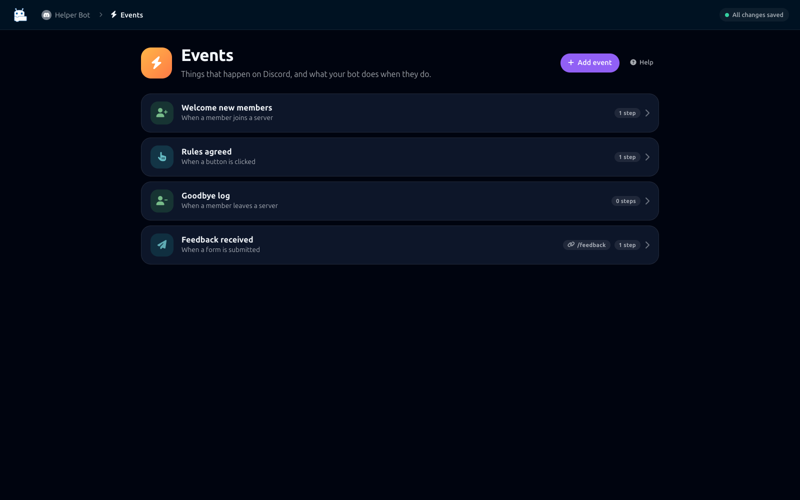
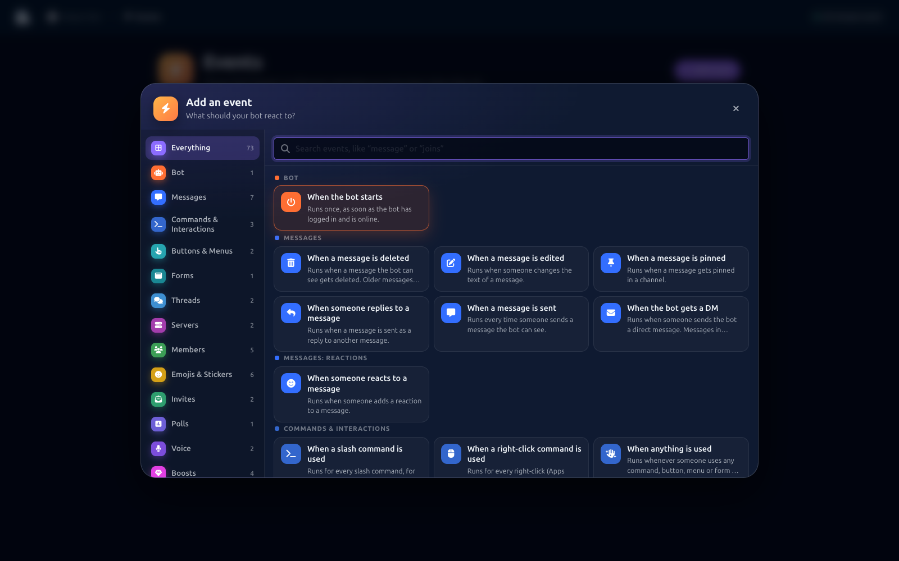
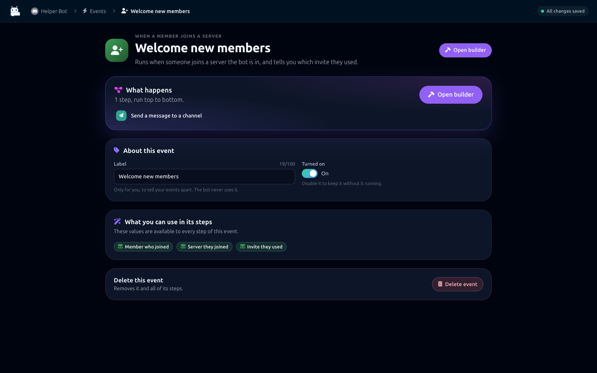

# Events

Events are things that happen on Discord, and what your bot does when they do: a member joins, a message is sent, someone clicks a button, the bot starts up.

## Adding an event

Click **Add event**. The picker lists every event by category. Search to find one quickly, like "joins" or "message".

Then give it a label, like "Welcome new members". The label is only for you, so you can tell your events apart. A project can have up to 300 events, and the same kind of event more than once.

## An event's page

Click an event to open its page.

| Section | What it's for |
| --- | --- |
| **What happens** | The steps it runs. Click **Open builder** to change them. See [Steps](steps.md). |
| **About this event** | Its label, and whether it's **On**. Turn it off to keep it without it running. |
| **Settings** | Some events can be narrowed down, like only running for one button ID or ignoring messages from bots. |
| **What you can use in its steps** | The [values](values.md) the event gives you, like the member who joined or the message that was sent. |

## Buttons, menus and forms

Buttons, menus and forms have an **ID**, like `agree`. When someone clicks a button, the **When a button is clicked** event runs, and its settings decide which IDs it runs for.

You rarely need to set this up by hand. Under a step that sends buttons or menus, or shows a form, DisFuse Builder lists each ID. Each one links to the event that handles it, or has a button that makes that event with the ID already filled in.

## Events vs commands

You don't need an event for your commands. Each command has its own steps on its own page. The **When a slash command is used** event is only for handling every command in one place, which most bots never need.
