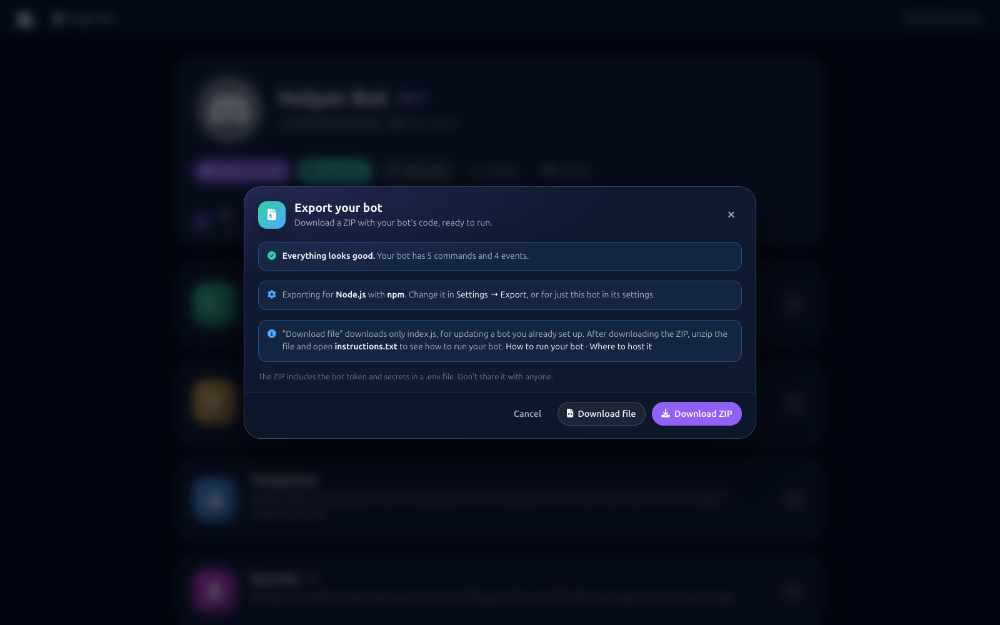
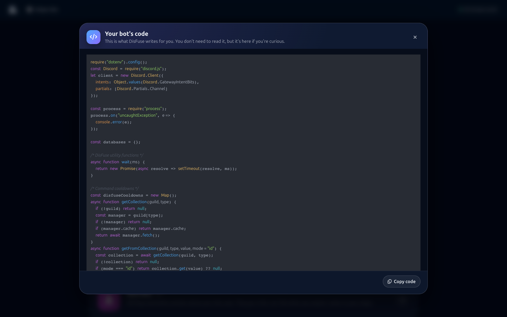

# Exporting your bot

Click **Export bot** on the project's dashboard to download your bot's code.

On a project with [versions](versions.md), choose which version to export at the top of the dialog. It starts on the one you're editing.

Before it downloads, DisFuse Builder checks your project. Anything that might not do what you want, like a step with an empty box, is listed under **A few things to check**. Your bot will still run.

| Button | What you get |
| --- | --- |
| **Download ZIP** | Everything your bot needs: its code, `package.json`, a `.env` file with the bot token and your [secrets](../Guide/secrets.md), and `instructions.txt` explaining how to run it. |
| **Download file** | Only `index.js`. Use it to update a bot you've already set up, by replacing its `index.js` and restarting it. |

:::warning
The ZIP has your bot token and secrets in its `.env` file. Don't share it with anyone.
:::

Then see [Running your bot](../Guide/running-your-bot.md) and [Hosting](../Help/hosting.md) to put it online.

## Runtime and package manager

The export is set up for **Node.js** with **npm** unless you choose otherwise. Change it for all your bots in **Settings**, then **Export**, or for one bot in its project settings. The export dialog shows which it's using.

## Seeing the code

**View code** on the dashboard shows the code DisFuse writes for your bot, without downloading anything. You don't need to read it, but it's there if you're curious.

