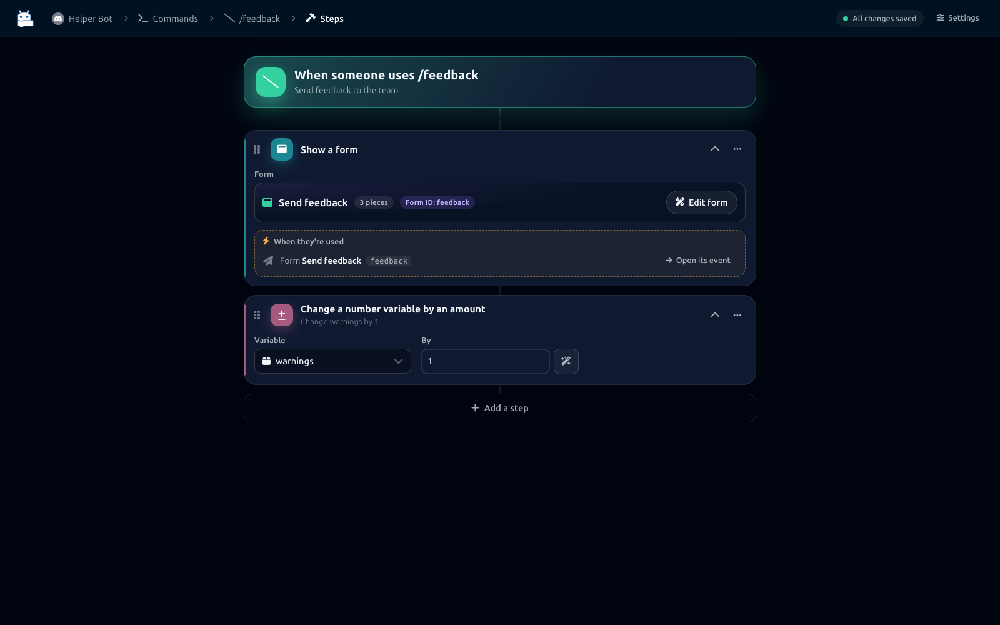
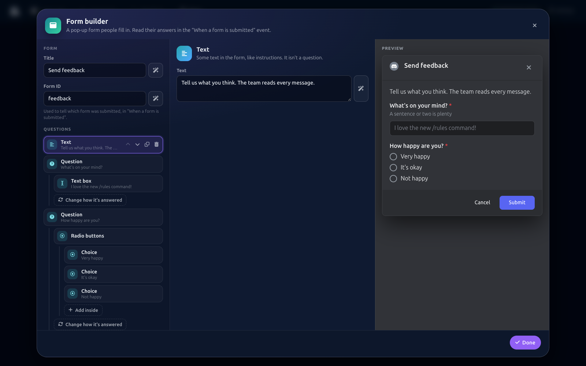
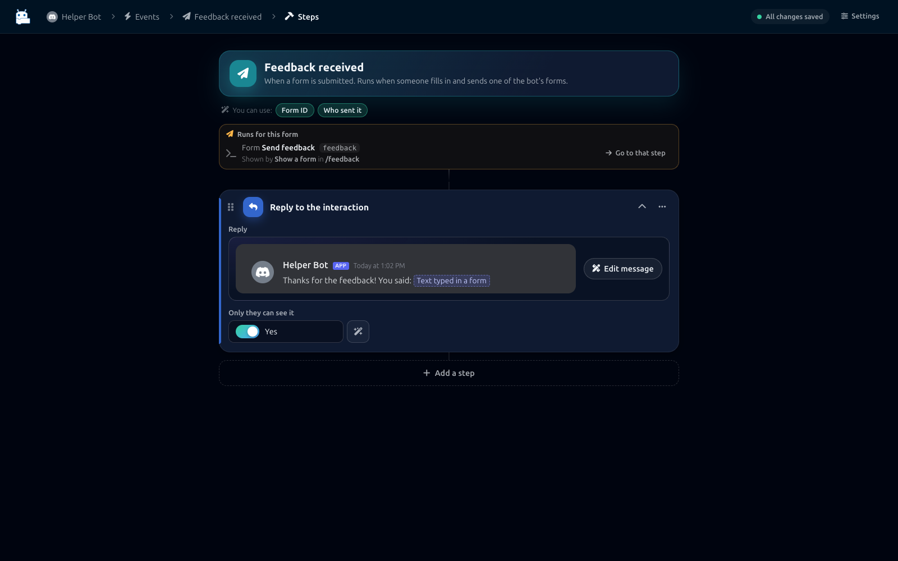

# Forms

A form is a pop-up people fill in, shown when they use a command, click a button or pick from a menu. Discord calls them modals.

## Showing a form

Add the **Show a form** step, then click **Build form**.

:::info
A form has to be the first answer to a command, button or menu. It can't come after a reply.
:::

## The form builder

Give the form a **Title**, shown at its top, and a **Form ID**, like `feedback`. The ID is how your bot knows which form was sent.

Then add **Questions**. Each question has a label and an optional description, and one way of answering it:

| Answer | What people do |
| --- | --- |
| **Text box** | Type a short or long answer. |
| **Menu** | Pick from a list of options. |
| **User**, **Role**, **Channel** or **User or role** menu | Pick from the server's users, roles or channels. |
| **File upload** | Upload one or more files. |
| **Radio buttons** | Pick one choice. |
| **Checkboxes** | Check any number of boxes. |

Each answer has its own ID too, like `message`. **Change how it's answered** swaps a question's answer for another kind.

A **Text** piece adds instructions to the form without asking anything.

The preview on the right shows the form as people will see it in Discord.

## Reading the answers

When someone sends the form, the **When a form is submitted** event runs. Set its **Only for this form ID** setting to your form's ID, so it only runs for that form. Under the **Show a form** step, DisFuse Builder offers to make that event for you.

In its steps, the **Text typed in a form**, **Options picked in a form menu** and other form values read each answer by its ID.

