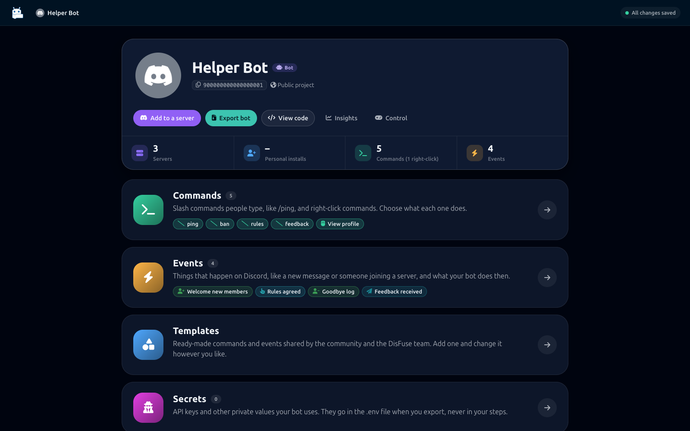
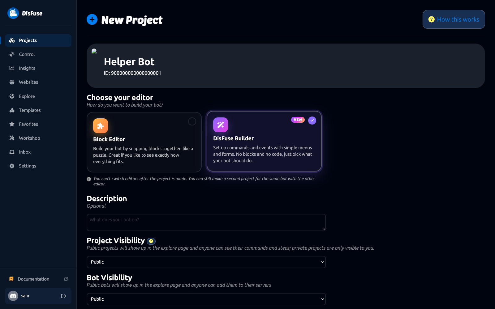
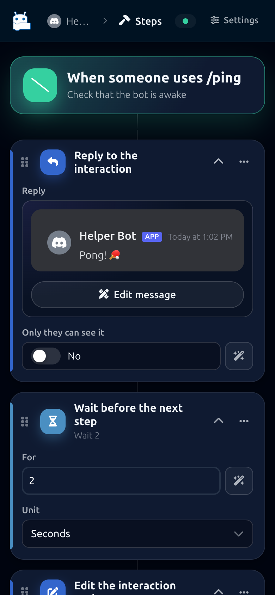

# DisFuse Builder

DisFuse Builder is the second way to make a bot on DisFuse. Instead of snapping blocks together, you pick what your bot should do from menus and fill in a few boxes. There are no blocks and no code, but what you make is the same real [discord.js](https://discord.js.org) bot, exported the same way.

:::tip
Already have a project made with blocks? You can copy it into DisFuse Builder at any time. See [Copy a block project](copy-from-blocks.md).
:::

## How it works

A DisFuse Builder project is made of three things.

| Piece | What it is |
| --- | --- |
| **[Commands](commands.md)** | Slash commands people type, like `/ping`, and right-click commands. Each one has its own page with its options and settings. |
| **[Events](events.md)** | Things that happen on Discord, like a member joining, a message being sent or a button being clicked. |
| **[Steps](steps.md)** | What the bot does when a command is used or an event happens, in order: reply, send a message, give a role, wait, check something and more. |

Steps have boxes to fill in. Any box can hold plain text, or a **[value](values.md)** like the member who used the command or the server's member count. Messages are made in the **[message builder](message-builder.md)**, and pop-up forms in the **[form builder](forms.md)**.

## Making a project

When you [create a project](../Guide/creating-a-project.md), choose **DisFuse Builder** as its editor.

:::info
A project's editor can't be changed after it's made. You can make a second project for the same bot with the other editor, or [copy a block project](copy-from-blocks.md) into a new DisFuse Builder project.
:::

## The dashboard

Opening a DisFuse Builder project takes you to its dashboard. At the top is your bot, with buttons to add it to a server, [export it](exporting.md), see its code, and open [Insights](../Features/insights.md) and [Control](../Features/control.md). Under it are cards for each part of the project:

- **Commands** and **Events**, with a chip for each one so you can jump straight to it.
- **Templates**, to add ready-made commands and events. See [Templates](../Guide/templates.md).
- **Secrets**, for API keys and other private values. See [Secrets](../Guide/secrets.md).
- **Collaborators**, to build the bot with other people. See [Collaborators](collaborators.md).
- **Settings**, the same project settings as any other project.

Everything saves as you go. The top right of every page shows whether your changes are saved.

## What works with it

Almost everything on DisFuse works with DisFuse Builder projects:

- [Collaborators](collaborators.md), with permissions for exactly what each person can change
- [Secrets](../Guide/secrets.md), [templates](../Guide/templates.md) and [exporting](exporting.md)
- [Insights](../Features/insights.md), [Control](../Features/control.md) and [Websites](../Features/websites.md)
- [Workshop packs](workshop-packs.md), whether they were made with blocks or with DisFuse Builder
- [Versions](versions.md), to keep snapshots of your bot and switch between them

One thing is only in the block editor: BlockBuddy.

## Phones and tablets

DisFuse Builder works on small screens too. Pages stack into one column, and pickers and editors open as sheets from the bottom of the screen.

## Where to go next

1. [Make a command](commands.md)
2. [Add steps to it](steps.md)
3. [Build a message](message-builder.md)
4. [React to events](events.md)
5. [Export your bot](exporting.md)
