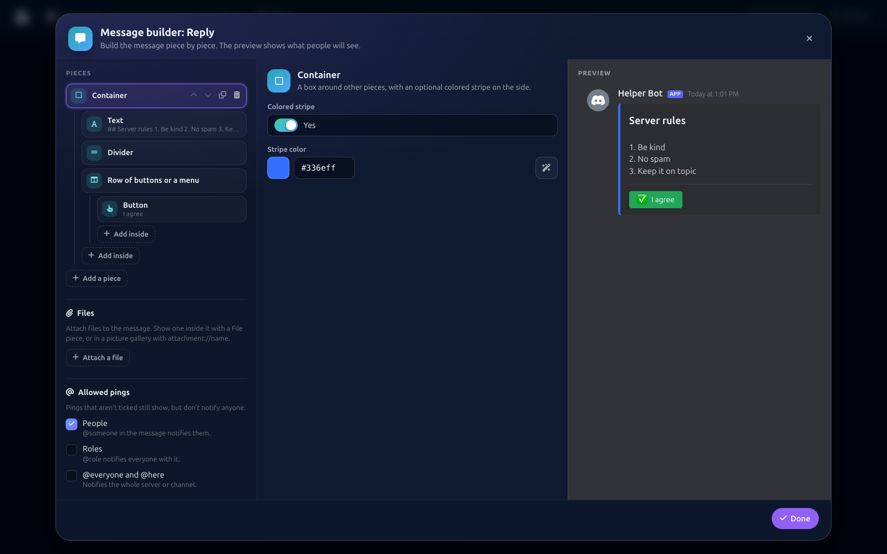

# Message builder

Steps that send or edit a message, like **Reply to the interaction** or **Send a message to a channel**, show a small preview of the message and an **Edit message** button. That opens the message builder.

It has three columns:

- **Pieces** on the left: everything in the message, as a list you can nest.
- The selected piece's settings in the middle.
- A live **Preview** on the right that looks like Discord.

On a phone, **Build** and **Preview** are two tabs at the top.

## Pieces

Click **Add a piece** to add one. Containers and rows have **Add inside** for the pieces that go in them.

| Piece | What it is |
| --- | --- |
| **Text** | Text, with Discord's markdown: `**bold**`, `## headings`, lists and links. |
| **Container** | A box around other pieces, with an optional colored stripe on the side. |
| **Divider** | A line or a gap between pieces. |
| **Text with a picture** | Text with a small picture beside it. |
| **Text with a button** | Text with a button beside it. |
| **Picture gallery** | One or more pictures. |
| **File** | A file attached to the message, shown inside it. |
| **Row of buttons or a menu** | Up to 5 buttons, or one menu. |
| **Button** | A button people click, or a link. |
| **Menu** | A dropdown of options, or of users, roles, channels or both users and roles. |

The arrows on a piece move it up and down. The other buttons duplicate and delete it.

Any text in a piece can use [values](values.md), like the member's name. They show as chips in the preview.

## Buttons and menus

Buttons and menus need an **ID**, like `agree`, so your bot knows which one was used. Under the step, DisFuse Builder lists each ID with a link to the [event](events.md) that handles it, or a button to make that event.

Link buttons have a URL instead of an ID, and don't need an event.

## Files

Under the pieces, **Files** attaches files to the message. Show one inside the message with a **File** piece, or in a picture gallery with `attachment://` and its name.

## Allowed pings

Under the files, **Allowed pings** decides who the message can notify.

| Option | When checked |
| --- | --- |
| **People** | Mentioning someone in the message notifies them. On by default. |
| **Roles** | Mentioning a role notifies everyone with it. |
| **@everyone and @here** | `@everyone` and `@here` notify the whole server or channel. |

Mentions that aren't checked still show in the message, but don't notify anyone. This keeps a message that repeats what someone typed from pinging the whole server.
