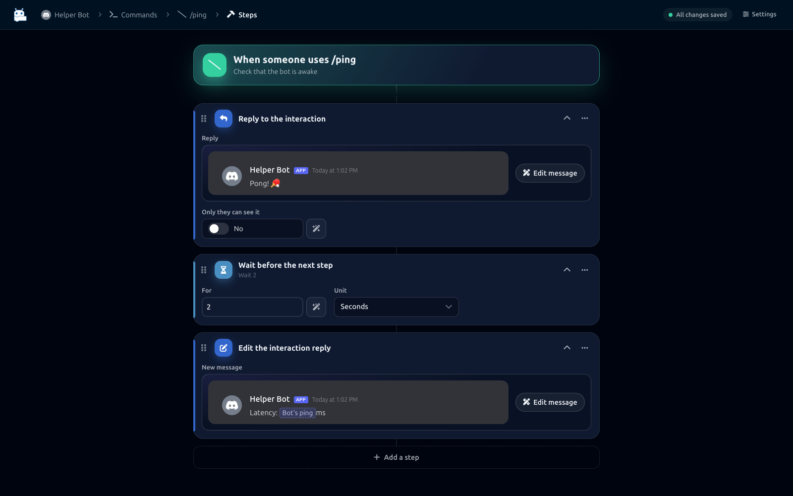
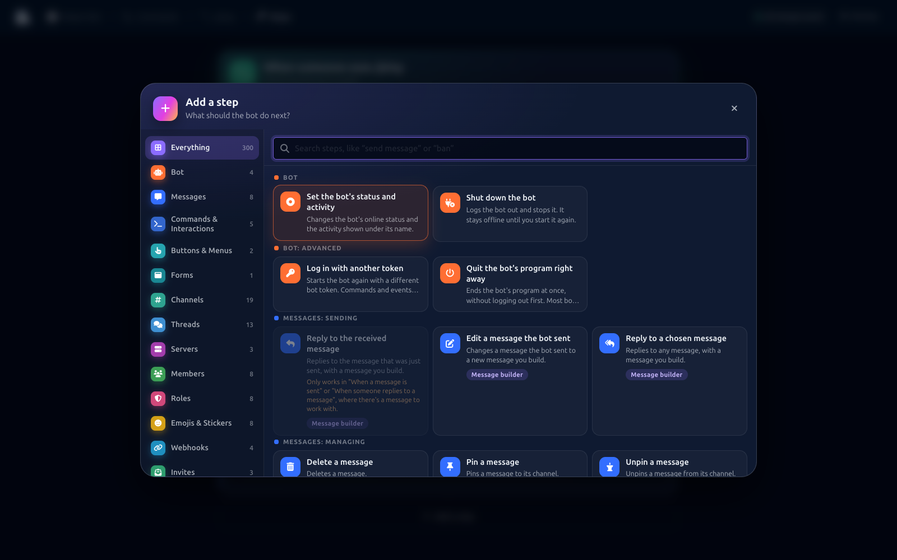
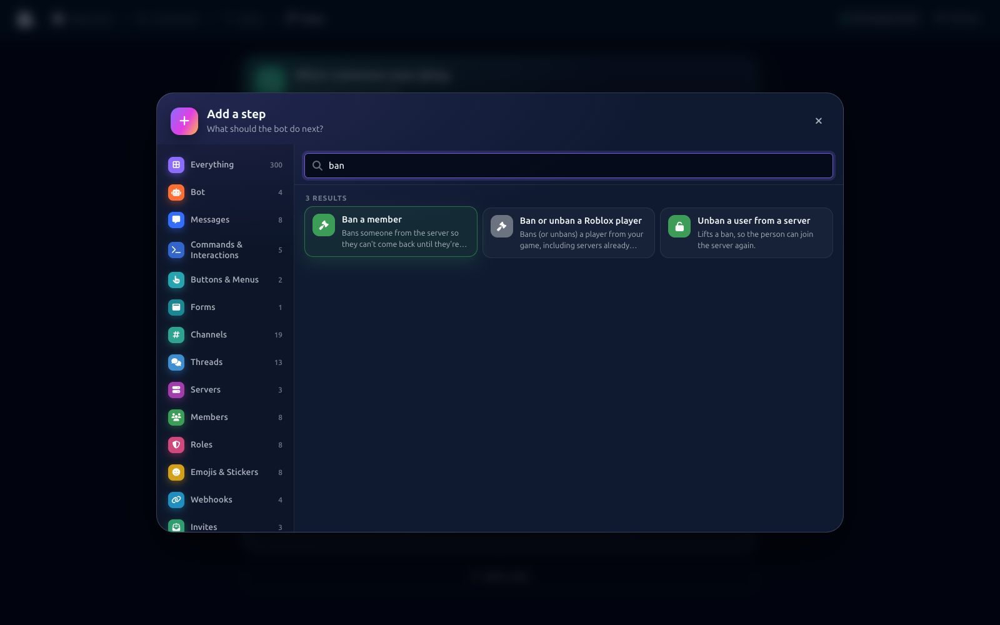

# Steps

Steps are what your bot does. Every command and every event has its own list of steps, and they run top to bottom.

Open them with **Open builder** on a command's or event's page. At the top is what starts them, like **When someone uses /ping**.

## Adding a step

Click **Add a step** at the bottom, or the **+** that shows between two steps to add one there. The picker lists every step by category.

Search to find one quickly. Steps that can't be used where you're adding them are grayed out, with the reason under them. For example, **Reply to the received message** only works in an event where there's a message to reply to.

## Filling in a step

Each step has boxes to fill in: text, numbers, switches, dropdowns, colors. A warning badge on a step means something still needs filling in, and the step says what.

Next to most boxes is the wand button. It lets the box use a [value](values.md) instead of something you type, like the member who joined or the bot's ping.

Some steps have steps of their own inside them:

- **If** steps have a section that runs when the check is true, and can have **Otherwise** sections.
- **Repeat** steps run the steps inside them once for each item.
- Steps like **Send a message to a channel** can run more steps **After it's sent**, with the message they sent.

Click a section's **+** to add steps inside it.

## Moving and changing steps

| To | Do this |
| --- | --- |
| **Move** a step | Drag it by the handle on its left. |
| **Collapse** a step | Click the arrow at its top right. |
| **Duplicate**, **disable** or **delete** a step | Open the **...** menu at its top right. |

A disabled step stays where it is, but is skipped when the bot runs. Deleting a step deletes the steps inside it too. A toast after deleting lets you **Undo** it.
