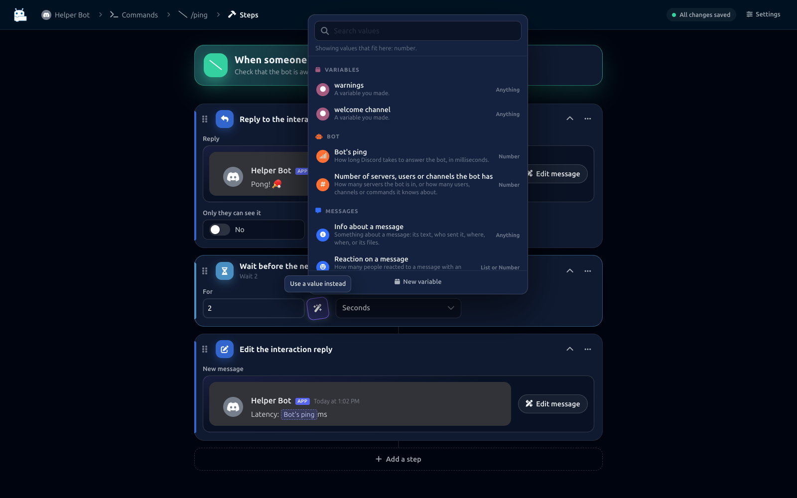
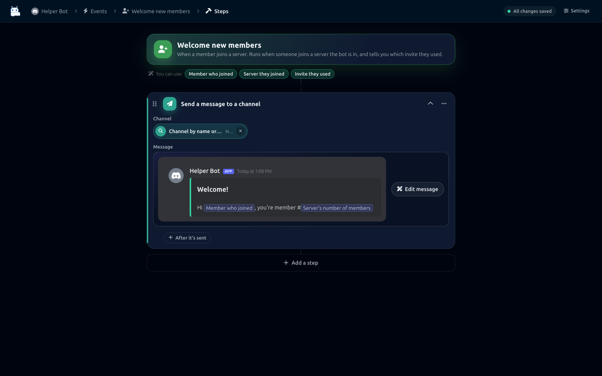

# Values

A value is something your bot only knows when a step runs: the member who joined, the text someone typed, the server's member count, the bot's ping. Any box on a step can use a value instead of what you type.

## Using a value

Click the wand button next to a box. The value picker opens, showing only the values that fit that box. A number box shows numbers, a channel box shows channels, and so on.

Pick one, and the box turns into a **pill** with the value's name.

- Some values need details of their own, like **Channel by name or ID**. Click the pill to fill them in.
- Click the pill's **×** to go back to typing.

## Where values come from

| Source | Examples |
| --- | --- |
| **The command or event** | The member who used the command, an option they filled in, the member who joined, the message that was sent. |
| **Earlier steps** | The message a step sent, a list a step made, the item a **Repeat** step is on. |
| **Your [variables](variables.md)** | Anything you saved earlier. |
| **Everywhere** | The bot's ping, the time, random numbers, text you change or join together. |

An event lists the values it gives you under **You can use** at the top of its steps.

## Values in text

Text boxes and messages can mix words and values, like "Welcome, *member*! You're member #*count*". Values show as highlighted chips in the text and in the message preview, and are replaced with the real thing when the bot runs.
