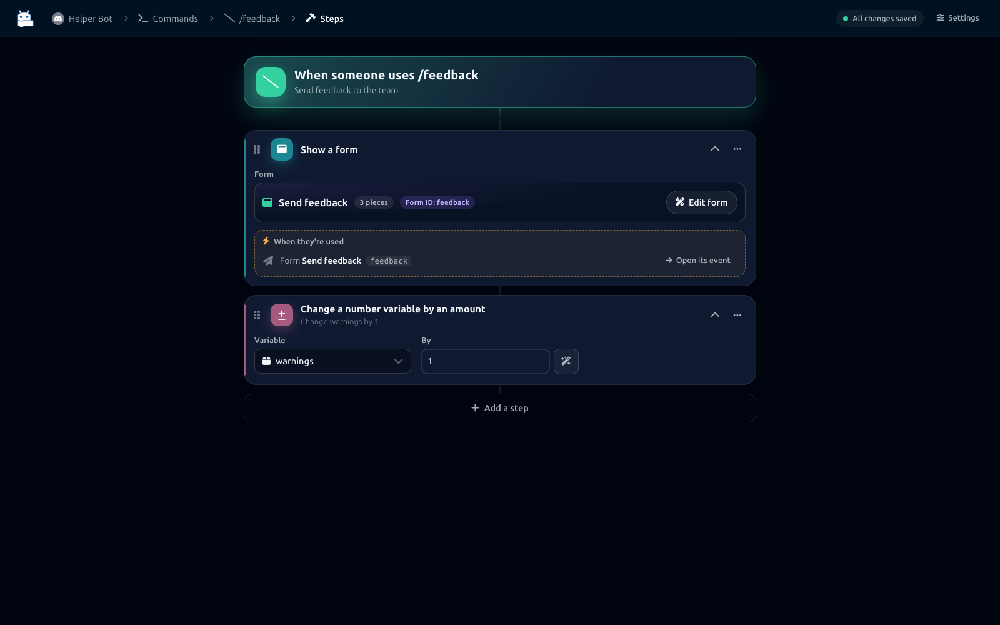

# Variables

A variable is a named box your bot keeps something in, so a later step, or a later command or event, can use it.

## Making one

Variables are made where you use them. In the [value picker](values.md), or in a step that changes a variable, pick **New variable** and give it a name. A project can have up to 500.

## Using them

| Step | What it does |
| --- | --- |
| **Set a variable** | Saves a value in it, replacing what was there. |
| **Change a number variable by an amount** | Adds to it, or takes away with a negative number. |
| **Add text to the end of a variable** | Adds text after what's already in it. |

To read a variable, pick it in the value picker. Your variables are listed first, under **Variables**.

## What to keep in them

Variables are shared by the whole bot: every command and every event sees the same ones. They live in the bot's memory, so they start empty again every time the bot restarts.

To keep something across restarts, or separately for each server or member, use the database steps instead.
