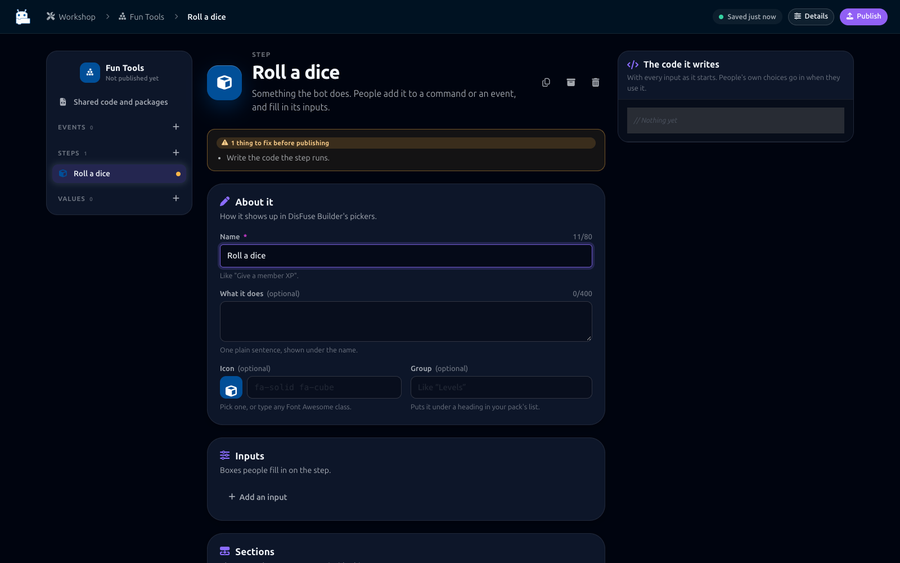
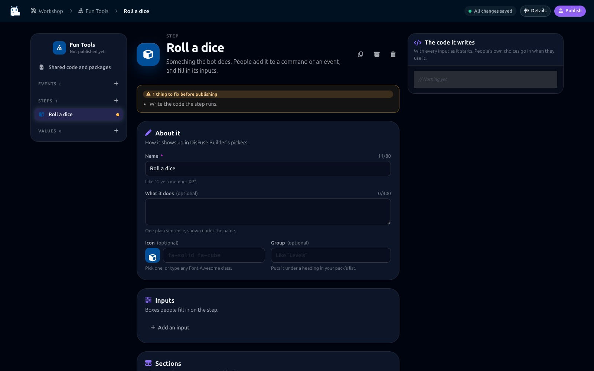

# Workshop packs

[Workshop](../Features/workshop.md) packs add new events, steps and values to DisFuse. Every pack works in every project, whichever editor the pack or the project was made with:

- A pack made with blocks shows up in DisFuse Builder as events, steps and values.
- A pack made with DisFuse Builder shows up in the block editor as blocks.

Packs you've installed appear in the pickers under a **Workshop** heading, each in its pack's color.

## Making a pack with DisFuse Builder

In the Workshop, click **Create** and choose **Build it with DisFuse Builder**. Then give it a name, a description and its visibility.

The list on the left has the pack's **Events**, **Steps** and **Values**. Click a **+** to add one.

Each item has:

| Section | What it's for |
| --- | --- |
| **About it** | Its name, a sentence on what it does, an icon, and an optional group to put it under in your pack's list. |
| **Inputs** | The boxes people fill in, like the text box on a step. |
| **Sections** | Places for more steps inside it, like an If step's **then**. |
| **Code** | The JavaScript it writes. Inputs go in with `{{name}}`. |

**The code it writes** on the right shows the code with every input as it starts, so you can check it as you go. **Shared code and packages** holds code that every item can use, and the npm packages the pack needs.

## Publishing

Click **Publish** at the top right. Each version needs a version number higher than the last, like `1.0.1`, and a short changelog.

The list of things to fix at the top of each item has to be empty first. DisFuse also refuses a version that would break projects already using the pack, like removing an item or an input they rely on. To retire an item without breaking anyone, archive it instead.

## Archiving items

The archive button at the top of an item hides it from the pickers of anyone installing your pack, and from the Workshop page's count. Projects that already use it keep working, because it's still in the pack. **Restore** brings it back.

The same works for packs made with blocks: archived blocks are hidden from the toolbox, but projects already using them keep working.
