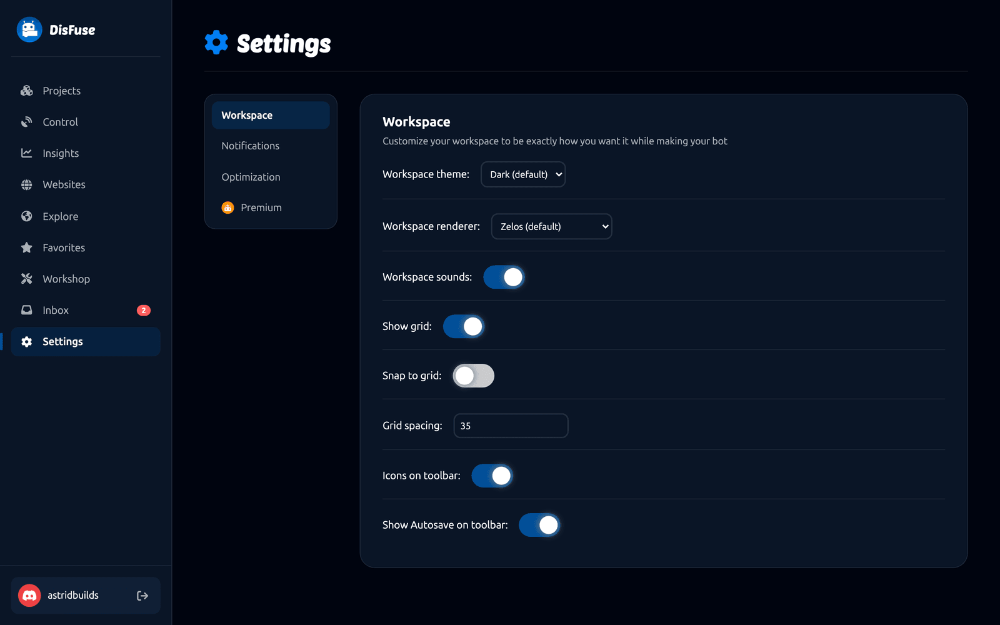
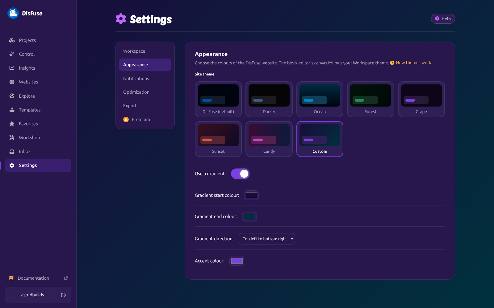
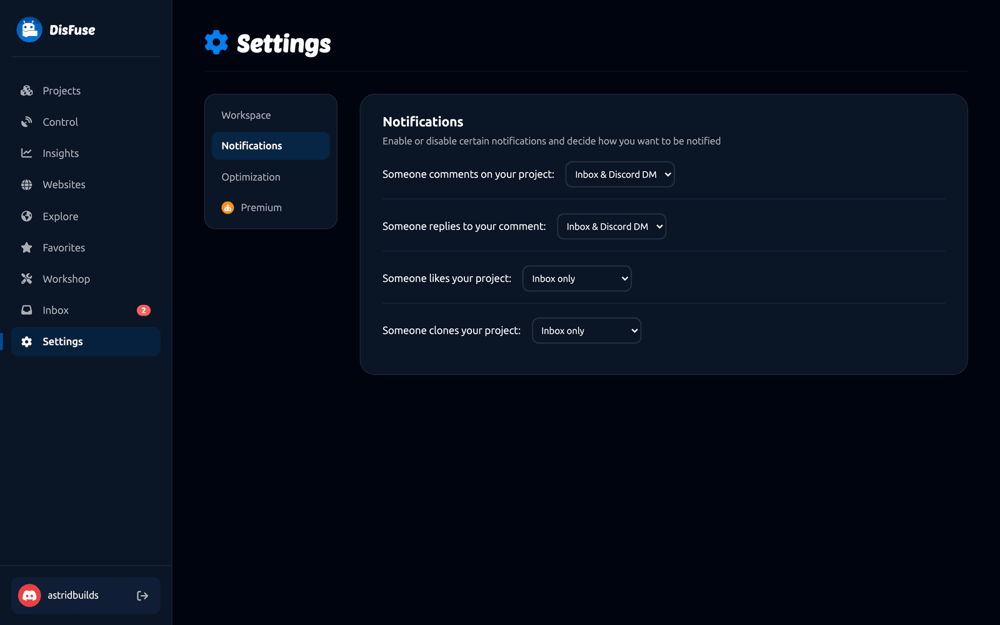
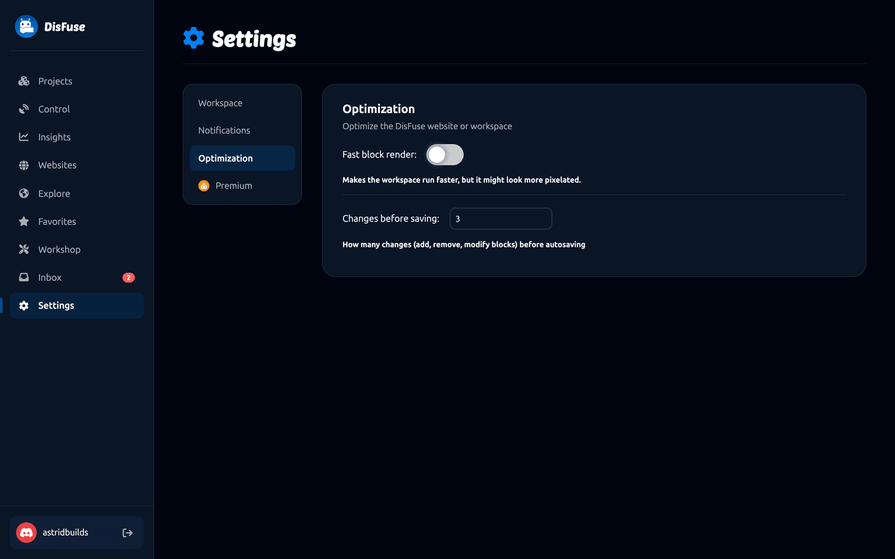
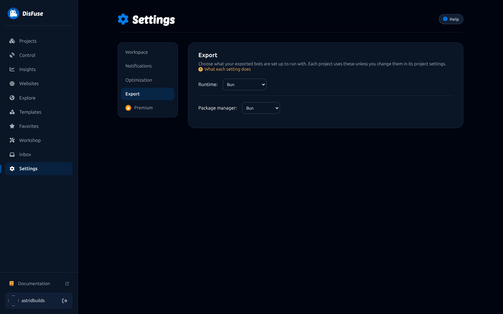
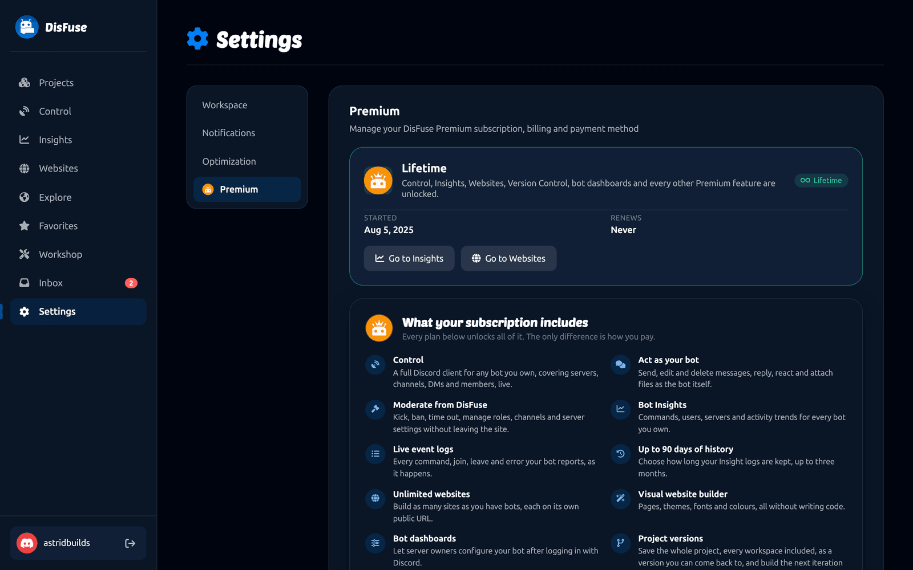

# Settings

Reached from **Settings** in the dashboard sidebar.

## Workspace

How the block editor looks and behaves.

| Setting | What it does |
| --- | --- |
| **Workspace theme** | The editor's color scheme. Dark, Darker, Light, Blue and Black, or Candy. Block colors stay the same in every theme, so a Text block is always the same green. |
| **Workspace renderer** | The shape of the blocks. Zelos is the rounded scratch-like default; Geras and Thrasos are Blockly's more angular shapes. |
| **Workspace sounds** | The click when blocks connect and the sound when one is deleted. |
| **Show grid** | The dotted grid on the canvas. |
| **Snap to grid** | Blocks line up to the grid when dropped. Makes a busy canvas much tidier. |
| **Grid spacing** | How far apart the dots are. |
| **Icons on toolbar** | The icons next to the toolbar buttons. Turn them off for a plainer bar. |
| **Show Autosave on toolbar** | The saving indicator. |

Changes apply the next time you open a project.

## Appearance

The colors of the DisFuse website itself: the dashboard, settings, the home page and the editor's toolbar. The block canvas keeps your [Workspace theme](#workspace).

**Site theme** is one of the presets (DisFuse, Darker, Ocean, Forest, Grape, Sunset or Candy) or **Custom**. A theme applies as soon as you click it, and follows you to any device you sign in on.

With **Custom** you choose:

| Setting | What it does |
| --- | --- |
| **Use a gradient** | Fade the page background between two colors instead of using one. |
| **Background** / **Gradient start color** | The page background, or where the gradient starts. |
| **Gradient end color** | Where the gradient ends. |
| **Gradient direction** | Which way the gradient runs, such as left to right or top to bottom. |
| **Accent color** | Buttons, highlights and the selected item in menus. |

Panels and cards are worked out from your background and accent, so they always match.

:::tip
Text on DisFuse is light, so dark backgrounds read best. DisFuse warns you if you pick a light one.
:::

## Notifications

What you are told about, and where.

| Event | |
| --- | --- |
| Somebody comments on your project | |
| Somebody replies to your comment | |
| Somebody likes your project | |
| Somebody clones your project | |

Each one can be set to:

- **Inbox and Discord DM**, which sends a direct message as well as an inbox item
- **Inbox only**
- **Off**

:::info
Discord DMs need your DMs open to members of the DisFuse server. If you have those closed, DisFuse cannot reach you and only the inbox is used.
:::

## Optimization

For big projects and slower computers.

**Fast block render** makes the editor faster by rendering blocks more crudely. Text and edges look rougher. Worth turning on if a large workspace feels sluggish.

**Changes before saving** is how many block changes happen before DisFuse saves. The default is 3.

- A **lower** number saves more often, which is safer and slightly busier.
- A **higher** number saves less often, which is lighter on a slow connection but risks losing more if the tab closes.

Saving always happens on a timer as well, so nothing is ever left unsaved for long.

## Export

What your bots are set up to run with when you [export](../Guide/running-your-bot.md) them.

**Runtime** is the program that runs your bot.

- **Node.js** (default) runs it with `node index.js`.
- **Bun** runs it with `bun index.js`. Bun reads the `.env` file by itself, so the export leaves out the `dotenv` library.

**Package manager** installs the libraries your bot needs: **npm** (default), **pnpm**, **Yarn** or **Bun**. It changes the commands in `instructions.txt`, such as `pnpm install` and `pnpm start`.

These are the defaults for every project. To use something else for one bot, change it in that project's [settings](../Guide/project-settings.md#export).

## Premium

Your subscription: what plan you are on, when it renews, and how to change or cancel it.

See [DisFuse Premium](premium.md).

## Where other settings live

| Setting | Where |
| --- | --- |
| Project description, visibility, permissions, bot token, export override | [Project settings](../Guide/project-settings.md) |
| Secrets | `Utilities > Secrets` in the editor. See [Secrets](../Guide/secrets.md) |
| Collaborators | **Invite** in the editor. See [Collaboration](../Guide/collaboration.md) |
| Insights retention | The bottom of the [Insights](insights.md) dashboard |
| Website theme and dashboard access | The Site tab of the [website builder](websites.md) |
